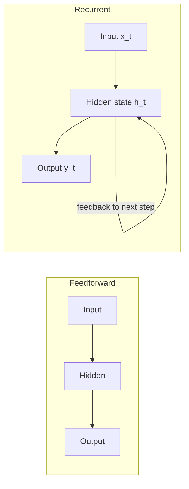

**In simple words:** a feedforward network sends data one way only, so it has no memory. A recurrent network feeds its memory (the hidden state) back in at every step, so it can work on sequences. <Cite id="class-dl-m1" loc="p. 10" />

**Feedforward neural network (FFNN):** the layers are input, hidden and output; data moves only from input to output and there is no loop. Each neuron finds $z = \sum_i w_ix_i + b$ and gives $a = f(z)$, and the output goes to the next layer. The output depends only on the current input. <Cite id="class-dl-chp1" loc="slide 28" />

**Recurrent neural network (RNN):** at every time step the cell takes the current input $x_t$ and the previous hidden state $h_{t-1}$ and gives a new hidden state $h_t$ and an output. The same weights are used at every step. <Cite id="class-dl-chp5" loc="slide 7" /> <Cite id="class-dl-m5" loc="p. 9" />

| | Feedforward | Recurrent |
|---|---|---|
| Data flow | One way, no loop | Hidden state fed back |
| Memory | None | Remembers earlier inputs |
| Input | Fixed-size input | Sequence of any length |
| Use | Tabular data, classification | Text, speech, time series |

**Conclusion:** FFNN handles one input at a time; RNN adds memory for ordered data. <Cite id="class-dl-chp5" loc="slide 5" />
