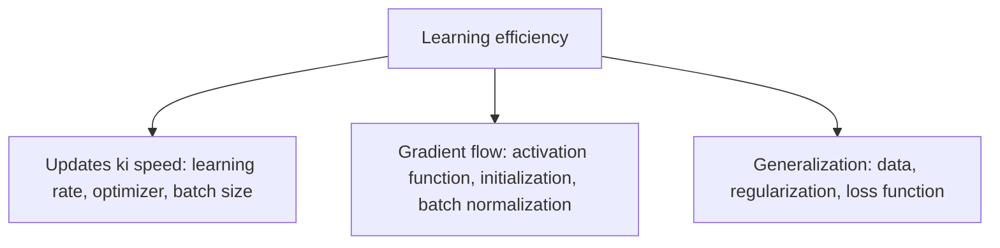

**In simple words:** deep network tab achha seekhta hai jab uske weights tezi se aur steadily improve hon. Learning efficiency ka matlab hai ki loss kitni tez aur stable tarah se kam hota hai aur model naye data par kitna achha chalta hai. Class files mein ye factors ek jagah list nahi hain; yahan training ke topics se ikatthe kiye gaye hain.

| Factor | Learning par effect |
|---|---|
| Learning rate | Bahut chhota to slow learning, bahut bada to minimum skip ho sakta hai, sahi value se fast aur stable learning. <Cite id="class-dl-chp2" loc="slide 63" /> <Cite id="class-dl-m1" loc="p. 29" /> |
| Optimizer | Plain GD slow hai; momentum, AdaGrad, RMSProp aur Adam updates ko tez aur steady banate hain. <Cite id="class-dl-chp2" loc="slide 88" /> |
| Batch size | Chhote batches se noisy updates; bahut bade batches batch GD ki tarah slow. <Cite id="class-dl-chp2" loc="slide 73" /> |
| Activation function | Sigmoid aur tanh deep nets mein vanishing gradient dete hain; ReLU par kam asar hota hai. <Cite id="class-dl-chp2" loc="slide 65" /> |
| Weight initialization | He (ReLU ke liye) ya Xavier (sigmoid ya tanh ke liye) vanishing aur exploding gradients se bachate hain. <Cite id="class-dl-chp2" loc="slide 65" /> |
| Loss function | Task ke hisaab se honi chahiye (regression ke liye MSE, classes ke liye cross entropy) taaki gradients kaam ke hon. <Cite id="class-dl-chp2" loc="slide 26" /> |
| Data ki matra aur overfitting | Chhota dataset ya bahut epochs se model ratta maarta hai; regularization aur data augmentation madad karte hain. <Cite id="class-dl-chp2" loc="slide 97" /> |
| Batch normalization | Layer inputs ko similar range mein rakhta hai, isse training tez aur stable hoti hai. <Cite id="class-dl-chp2" loc="slide 112" /> |

**Conclusion:** achhi learning ke liye sahi learning rate, achha optimizer, healthy gradients aur enough data ke saath regularization chahiye.
