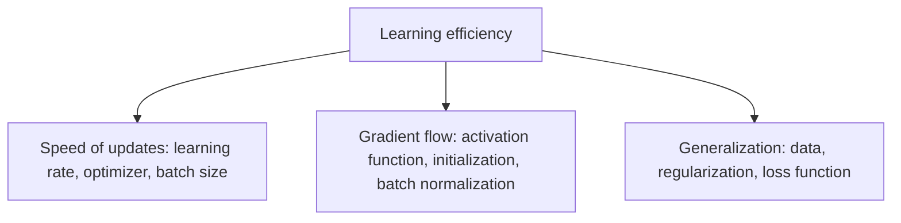

**In simple words:** a deep network learns well when its weights improve quickly and steadily. Learning efficiency means how fast and how stably the loss goes down and how well the model works on new data. The class files do not list these factors in one place; they are collected here from the training topics.

| Factor | Effect on learning |
|---|---|
| Learning rate | Too small gives slow learning, too large may skip the minimum, a proper value gives fast and stable learning. <Cite id="class-dl-chp2" loc="slide 63" /> <Cite id="class-dl-m1" loc="p. 29" /> |
| Optimizer | Plain GD is slow; momentum, AdaGrad, RMSProp and Adam speed up and steady the updates. <Cite id="class-dl-chp2" loc="slide 88" /> |
| Batch size | Small batches give noisy updates; very large batches are slow like batch GD. <Cite id="class-dl-chp2" loc="slide 73" /> |
| Activation function | Sigmoid and tanh cause vanishing gradients in deep nets; ReLU is less affected. <Cite id="class-dl-chp2" loc="slide 65" /> |
| Weight initialization | He (for ReLU) or Xavier (for sigmoid or tanh) avoid vanishing and exploding gradients. <Cite id="class-dl-chp2" loc="slide 65" /> |
| Loss function | It must suit the task (MSE for regression, cross entropy for classes) so the gradients are useful. <Cite id="class-dl-chp2" loc="slide 26" /> |
| Amount of data and overfitting | A small dataset or too many epochs makes the model memorize; regularization and data augmentation help. <Cite id="class-dl-chp2" loc="slide 97" /> |
| Batch normalization | Keeps the layer inputs in a similar range, so training is faster and more stable. <Cite id="class-dl-chp2" loc="slide 112" /> |

**Conclusion:** good learning needs a proper learning rate, a good optimizer, healthy gradients and enough data with regularization.
