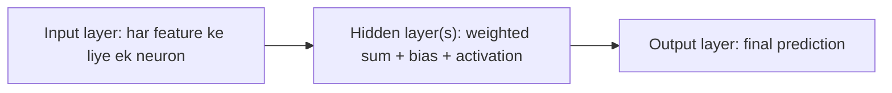

**In simple words:** feedforward neural network data ko teen tarah ki layers se ek hi direction mein bhejta hai. Input layer data leti hai, hidden layers patterns dhoondhti hain, aur output layer answer deti hai. <Cite id="class-dl-chp1" loc="slide 28" />

**Definition:** feedforward neural network (FFNN) ek aisa neural network hai jisme data sirf ek direction mein, input layer se output layer ki taraf jaata hai. Network mein koi feedback ya loop nahi hota. <Cite id="class-dl-chp1" loc="slide 28" />

**Layers ke functions** <Cite id="class-dl-m1" loc="p. 17" /> <Cite id="class-dl-chp1" loc="slide 22" />

| Layer | Function |
|---|---|
| Input layer | Input leti hai; har neuron ek input feature hai (teen features to teen neurons). Koi calculation nahi karti. |
| Hidden layer(s) | Input layer ki information process karti hain; important patterns calculate karke seekhti hain. Shuru ki hidden layers simple features, deeper layers complex patterns seekhti hain. |
| Output layer | Final prediction deti hai; kai outputs hon to utne neurons hote hain. |

**Working, step by step:** (1) input input layer ko diya jaata hai, (2) inputs weights se multiply hote hain, (3) bias add hota hai, (4) activation function lagta hai, (5) output agli layer ko jaata hai, (6) final output milta hai. Har neuron ke liye $z = \sum_i w_ix_i + b$ aur $a = f(z)$. <Cite id="class-dl-chp1" loc="slide 28" />

**Chhota example:** inputs $x = (2, 3)$, weights $w = (0.5, 0.4)$, bias $b = 0.1$. Tab $z = 0.5 \times 2 + 0.4 \times 3 + 0.1 = 2.3$; ReLU ke saath $a = \max(0, 2.3) = 2.3$, jo agli layer ko jaata hai. (Arithmetic dikhane ke liye banaya gaya example.)

**Learning:** output ko actual output se compare kiya jaata hai, error backpropagation se peeche bheja jaata hai, aur gradient descent weights adjust karta hai; ye tab tak repeat hota hai jab tak error minimum na ho. <Cite id="class-dl-chp1" loc="slide 11" /> <Cite id="class-dl-chp2" loc="slide 59" />

**Features aur limits:** hidden layer ke saath ye XOR jaise non-linear problems seekh sakta hai, par ise pichhle inputs ki memory nahi hoti. <Cite id="class-dl-chp1" loc="slide 23" />

**Conclusion:** har layer ka apna kaam hai, aur milkar wo raw input ko prediction mein badalti hain.
