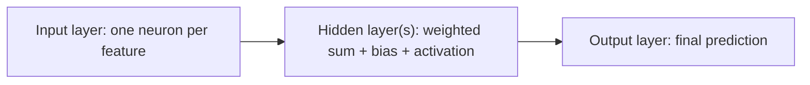

**In simple words:** a feedforward neural network passes data through three kinds of layers in one direction. The input layer takes the data, the hidden layers find patterns, and the output layer gives the answer. <Cite id="class-dl-chp1" loc="slide 28" />

**Definition:** a feedforward neural network (FFNN) is a type of neural network where data moves only in one direction, from the input layer to the output layer. There is no feedback or loop in the network. <Cite id="class-dl-chp1" loc="slide 28" />

**Functions of the layers** <Cite id="class-dl-m1" loc="p. 17" /> <Cite id="class-dl-chp1" loc="slide 22" />

| Layer | Function |
|---|---|
| Input layer | Takes the input; each neuron is one input feature (three features means three neurons). It does no calculation. |
| Hidden layer(s) | Process the information from the input layer; calculate and learn important patterns. Early hidden layers learn simple features, deeper ones learn complex patterns. |
| Output layer | Gives the final prediction; with several outputs it has that many neurons. |

**Working, step by step:** (1) input is given to the input layer, (2) inputs are multiplied with weights, (3) bias is added, (4) the activation function is applied, (5) the output goes to the next layer, (6) the final output is produced. For each neuron $z = \sum_i w_ix_i + b$ and $a = f(z)$. <Cite id="class-dl-chp1" loc="slide 28" />

**Tiny example:** inputs $x = (2, 3)$, weights $w = (0.5, 0.4)$, bias $b = 0.1$. Then $z = 0.5 \times 2 + 0.4 \times 3 + 0.1 = 2.3$; with ReLU, $a = \max(0, 2.3) = 2.3$, which goes to the next layer. (A made-up example to show the arithmetic.)

**Learning:** the output is compared with the actual output, the error is sent back by backpropagation, and gradient descent adjusts the weights; this repeats until the error is minimum. <Cite id="class-dl-chp1" loc="slide 11" /> <Cite id="class-dl-chp2" loc="slide 59" />

**Features and limits:** it can learn non-linear problems such as XOR when it has a hidden layer, but it has no memory of earlier inputs. <Cite id="class-dl-chp1" loc="slide 23" />

**Conclusion:** every layer has its own job, and together they turn the raw input into a prediction.
