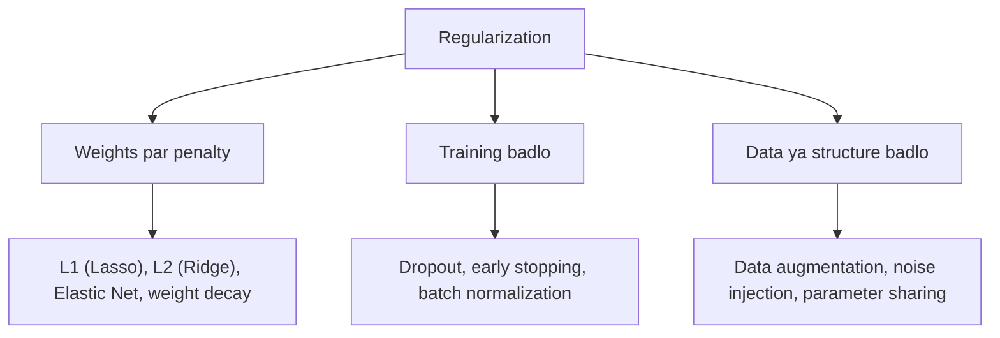

**In simple words:** bada network training data ko noise samet ratta maar sakta hai aur naye data par fail ho jaata hai. Regularization model ki complexity control karke ise rokta hai. <Cite id="class-dl-chp2" loc="slide 97" />

**Regularization ki zaroorat:** model training data ko zyada achhe se seekh leta hai (overfitting), isliye training accuracy bahut high aur testing accuracy low hoti hai. Causes: complex model, bahut epochs, chhota dataset aur noise. Zyada epochs se fayda nahi hota, kyunki model ratta maarne lagta hai. Regularization penalty jodta hai, yaani **Total Loss = Prediction Error + Regularization Penalty**, aur bade weights discourage hote hain. Goal hai better generalization. <Cite id="class-dl-chp2" loc="slides 93 and 97" />

**Techniques** <Cite id="class-dl-chp2" loc="slide 100" />

| Technique | Overfitting kaise kam karti hai |
|---|---|
| L1 (Lasso) | Loss mein $\lambda \sum \lvert w \rvert$ jodti hai; weights shrink hote hain, kai zero ya zero ke paas ho jaate hain. <Cite id="class-dl-chp2" loc="slide 101" /> |
| L2 (Ridge) | $\lambda \sum w^2$ jodti hai; bade weight par bada penalty, isliye sab weights chhote rehte hain. <Cite id="class-dl-chp2" loc="slide 103" /> |
| Elastic Net | L1 aur L2 dono penalties use karti hai. <Cite id="class-dl-chp2" loc="slide 105" /> |
| Dropout | Har training step mein random neurons off karta hai (rate aksar 0.5), isliye neurons ek doosre par depend nahi karte. Testing mein sab neurons use hote hain. <Cite id="class-dl-chp2" loc="slide 108" /> |
| Early stopping | Validation loss improve hona band hone par (patience ke baad) training rok deta hai aur best model rakhta hai. <Cite id="class-dl-chp2" loc="slide 113" /> |
| Data augmentation | Maujood samples se naye samples (flip, rotate, zoom) banata hai, isliye model ko zyada variety milti hai. <Cite id="class-dl-chp2" loc="slide 116" /> |
| Batch normalization | Layer outputs ko normalize karta hai, isse training tez aur stable hoti hai. <Cite id="class-dl-chp2" loc="slide 110" /> |
| Noise injection | Training mein inputs ya weights mein chhota random noise jodta hai. <Cite id="class-dl-chp2" loc="slide 119" /> |
| Parameter sharing | Wahi weights baar baar use hote hain (jaise CNN filter), isliye parameters kam. <Cite id="class-dl-chp2" loc="slide 120" /> |
| Weight decay | Har update par weights ko thoda shrink karta hai. <Cite id="class-dl-chp2" loc="slide 121" /> |

**$\lambda$ ka role:** $\lambda = 0$ matlab regularization nahi (overfit), chhota $\lambda$ best hai, bahut bada $\lambda$ underfit karta hai. <Cite id="class-dl-chp2" loc="slide 99" />

**Chhota example (L2):** weights $5, -3, 2, -1$ ka penalty $\lambda(25 + 9 + 4 + 1) = 39\lambda$ hai; sabse bada weight zyada penalty deta hai, isliye optimizer use pehle shrink karta hai. <Cite id="class-dl-chp2" loc="slide 104" />

**Conclusion:** regularization thodi training accuracy dekar unseen data par bahut better accuracy deta hai.
