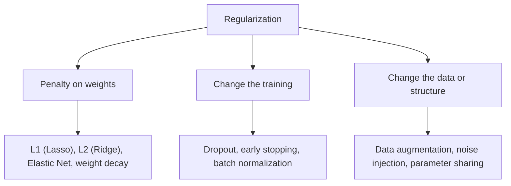

**In simple words:** a big network can learn its training data by heart, including the noise, and then fail on new data. Regularization stops this by controlling how complex the model can become. <Cite id="class-dl-chp2" loc="slide 97" />

**Need for regularization:** the model learns the training data too well (overfitting), so training accuracy is very high and testing accuracy is low. Causes are a complex model, too many epochs, a small dataset and noise. More epochs do not fix it, because the model starts memorizing. Regularization adds a penalty, so **Total Loss = Prediction Error + Regularization Penalty**, and large weights are discouraged. Its goal is better generalization. <Cite id="class-dl-chp2" loc="slides 93 and 97" />

**Techniques** <Cite id="class-dl-chp2" loc="slide 100" />

| Technique | How it reduces overfitting |
|---|---|
| L1 (Lasso) | Adds $\lambda \sum \lvert w \rvert$ to the loss; shrinks weights, many become zero or near zero. <Cite id="class-dl-chp2" loc="slide 101" /> |
| L2 (Ridge) | Adds $\lambda \sum w^2$; a large weight gets a large penalty, so all weights stay small. <Cite id="class-dl-chp2" loc="slide 103" /> |
| Elastic Net | Uses both L1 and L2 penalties. <Cite id="class-dl-chp2" loc="slide 105" /> |
| Dropout | Randomly switches off neurons in each training step (rate often 0.5), so neurons cannot depend on each other. All neurons are used in testing. <Cite id="class-dl-chp2" loc="slide 108" /> |
| Early stopping | Stops training when the validation loss stops improving (after the patience), and keeps the best model. <Cite id="class-dl-chp2" loc="slide 113" /> |
| Data augmentation | Makes new samples (flip, rotate, zoom) from existing ones, so the model sees more variety. <Cite id="class-dl-chp2" loc="slide 116" /> |
| Batch normalization | Normalizes layer outputs, so training is faster and more stable. <Cite id="class-dl-chp2" loc="slide 110" /> |
| Noise injection | Adds small random noise to inputs or weights during training. <Cite id="class-dl-chp2" loc="slide 119" /> |
| Parameter sharing | The same weights are reused (as in a CNN filter), so fewer parameters. <Cite id="class-dl-chp2" loc="slide 120" /> |
| Weight decay | Shrinks the weights a little at every update. <Cite id="class-dl-chp2" loc="slide 121" /> |

**Role of $\lambda$:** $\lambda = 0$ means no regularization (overfits), a small $\lambda$ is best, a very large $\lambda$ underfits. <Cite id="class-dl-chp2" loc="slide 99" />

**Small example (L2):** weights $5, -3, 2, -1$ give penalty $\lambda(25 + 9 + 4 + 1) = 39\lambda$; the largest weight causes most of it, so the optimizer shrinks it first. <Cite id="class-dl-chp2" loc="slide 104" />

**Conclusion:** regularization trades a little training accuracy for much better accuracy on unseen data.
