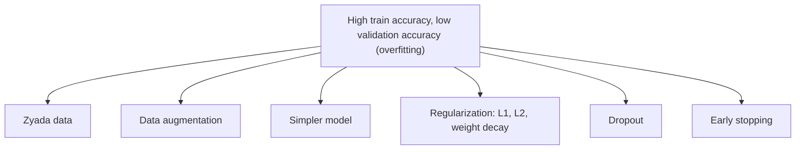

**In simple words:** model ne training data ratta maar liya hai, real pattern nahi seekha. Is problem ko **overfitting** kehte hain. Ye us student jaisa hai jo pichhle saal ke answers ratta maarta hai aur questions badalte hi fail ho jaata hai. <Cite id="class-dl-chp2" loc="slide 93" />

**Problem ki pehchaan:** overfitting ka matlab hai training accuracy bahut high par testing (validation) accuracy low. Model training data ko noise aur unnecessary details ke saath zyada achhe se seekh leta hai (high variance). Loss curves par training loss girta rehta hai jabki validation loss badhne lagta hai. <Cite id="class-dl-chp2" loc="slides 93 and 95" />

| | Underfitting | Good fit | Overfitting |
|---|---|---|---|
| Training accuracy | Low | High | Very high |
| Validation accuracy | Low | High | Low |
| Generalization | Poor | Excellent | Poor |

**Causes:** complex model, bahut epochs, chhota dataset aur data mein noise. <Cite id="class-dl-chp2" loc="slide 96" />

**Solutions**

1. **Zyada data lo** ya **data augmentation** (flip, rotate, zoom) use karo, taaki model ko zyada variety mile. <Cite id="class-dl-chp2" loc="slide 115" />
2. **Simpler model** use karo, kam layers ya neurons ke saath.
3. **L1 ya L2 regularization:** bade weights par penalty lagao (Total Loss = Prediction Error + Penalty). <Cite id="class-dl-chp2" loc="slide 97" />
4. **Dropout:** training mein random neurons off karo taaki neurons ek doosre par depend na karein. <Cite id="class-dl-chp2" loc="slide 108" />
5. **Early stopping:** validation loss improve hona band ho to training rok do aur best model rakho. <Cite id="class-dl-chp2" loc="slide 113" />

**Conclusion:** problem overfitting hai; training aur validation results compare karke pata chalta hai, aur zyada data, simpler model aur regularization se kam hota hai.
