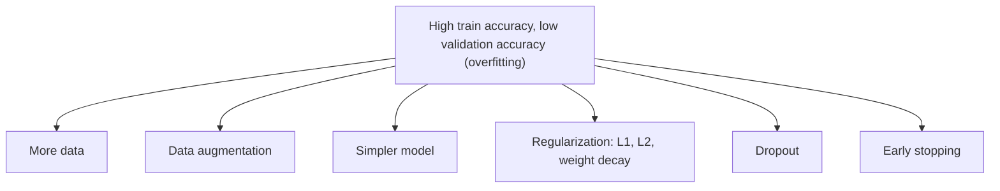

**In simple words:** the model has memorized the training data instead of learning the real pattern. This problem is **overfitting**. It is like a student who learns last year's answers by heart and fails when the questions change. <Cite id="class-dl-chp2" loc="slide 93" />

**Identifying the problem:** overfitting means very high training accuracy but low testing (validation) accuracy. The model learns the training data too well, including noise and unnecessary details (high variance). On the loss curves, the training loss keeps falling while the validation loss starts to rise. <Cite id="class-dl-chp2" loc="slides 93 and 95" />

| | Underfitting | Good fit | Overfitting |
|---|---|---|---|
| Training accuracy | Low | High | Very high |
| Validation accuracy | Low | High | Low |
| Generalization | Poor | Excellent | Poor |

**Causes:** a complex model, too many epochs, a small dataset and noise in the data. <Cite id="class-dl-chp2" loc="slide 96" />

**Solutions**

1. **Get more data** or use **data augmentation** (flip, rotate, zoom), so the model sees more variety. <Cite id="class-dl-chp2" loc="slide 115" />
2. **Use a simpler model** with fewer layers or neurons.
3. **L1 or L2 regularization:** add a penalty on large weights (Total Loss = Prediction Error + Penalty). <Cite id="class-dl-chp2" loc="slide 97" />
4. **Dropout:** randomly turn off neurons in training so neurons cannot depend on each other. <Cite id="class-dl-chp2" loc="slide 108" />
5. **Early stopping:** stop training when the validation loss stops improving and keep the best model. <Cite id="class-dl-chp2" loc="slide 113" />

**Conclusion:** the problem is overfitting; it is checked by comparing training and validation results and is reduced by more data, a simpler model and regularization.
