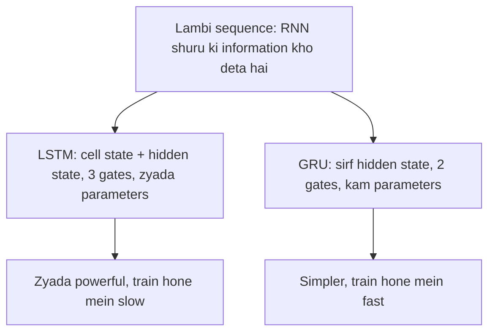

**In simple words:** plain RNN lambi sequence ka shuru ka hissa bhool jaata hai. LSTM aur GRU dono gates se ise fix karte hain. LSTM bada, zyada powerful cell hai; GRU halka cell hai jisme parameters kam hain, isliye wo tez train hota hai. <Cite id="class-dl-chp5" loc="slide 20" />

**Lambi sequences mushkil kyun hain:** lambi sequence mein BPTT ke dauran gradient vanish ho jaata hai, isliye basic RNN long-term dependencies seekh nahi pata. LSTM aur GRU dono iske solutions hain. <Cite id="class-dl-chp5" loc="slides 11 and 20" />

**Lambi sequences par comparison** <Cite id="class-dl-m5" loc="p. 31" />

| Feature | LSTM | GRU |
|---|---|---|
| Memory | Cell state (long term) + hidden state (short term) | Sirf hidden state |
| Gates | Forget, input, output (3) | Reset, update (2) |
| Long-term dependencies | Achhe se handle karta hai; cell state information door tak le jaata hai | Achhe se handle karta hai; update gate purani information rakhta hai |
| Structure aur parameters | Zyada complex, zyada parameters | Simpler, kam parameters |
| Training speed | Slow | Fast |
| Power | Zyada powerful aur effective | Control thoda kam |

**Performance:** dono long-range dependencies pakadte hain aur vanishing gradient problem kam karte hain. Class kehti hai LSTM zyada powerful hai kyunki usme do ki jagah teen gates hain, isliye bahut lambi ya complex sequences par accuracy sabse important ho to wo safe choice hai. GRU simpler design mein milta-julta kaam deta hai. Class files mein benchmark numbers nahi hain, isliye practice mein dono ko dataset par compare kiya jaata hai. <Cite id="class-dl-m5" loc="p. 31" /> <Cite id="class-dl-chp5" loc="slide 21" />

**Faster training ke liye choice: GRU.** Isme alag cell state nahi hai aur sirf do gates hain, isliye parameters kam aur har time step mein calculations kam hoti hain. Kam parameters ka matlab hum bade models bana sakte hain, aur training mein time aur memory kam lagti hai. <Cite id="class-dl-m5" loc="p. 31" />

**Conclusion:** faster training ke liye GRU chuno; lambi sequences par sabse zyada power chahiye to LSTM chuno.
