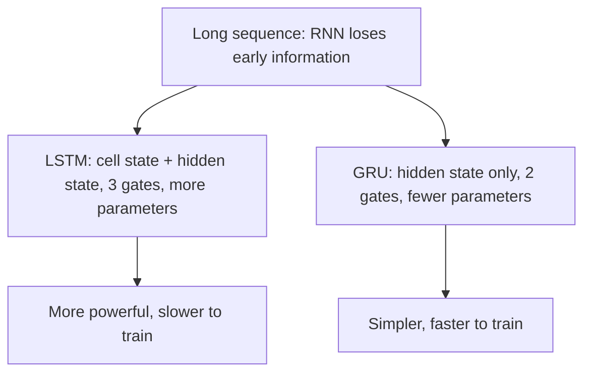

**In simple words:** a plain RNN forgets early parts of a long sequence. LSTM and GRU both fix this with gates. LSTM is the bigger, more powerful cell; GRU is the lighter one with fewer parameters, so it trains faster. <Cite id="class-dl-chp5" loc="slide 20" />

**Why long sequences are hard:** in a long sequence the gradient vanishes during BPTT, so a basic RNN cannot learn long-term dependencies. Both LSTM and GRU are the solutions. <Cite id="class-dl-chp5" loc="slides 11 and 20" />

**Comparison on long sequences** <Cite id="class-dl-m5" loc="p. 31" />

| Feature | LSTM | GRU |
|---|---|---|
| Memory | Cell state (long term) + hidden state (short term) | Hidden state only |
| Gates | Forget, input, output (3) | Reset, update (2) |
| Long-term dependencies | Handles them well; the cell state carries information far | Handles them well; the update gate keeps old information |
| Structure and parameters | More complex, more parameters | Simpler, fewer parameters |
| Training speed | Slower | Faster |
| Power | More powerful and effective | Slightly less control |

**Performance:** both capture long-range dependencies and ease the vanishing gradient problem. The class says LSTM is more powerful because it has three gates instead of two, so it is the safer choice when accuracy on very long or complex sequences matters most. GRU gives similar work with a simpler design. The class files give no benchmark numbers, so in practice the two are compared on the dataset itself. <Cite id="class-dl-m5" loc="p. 31" /> <Cite id="class-dl-chp5" loc="slide 21" />

**Choice for faster training: GRU.** It has no separate cell state and only two gates, so it has fewer parameters and fewer calculations in every time step. Fewer parameters also mean we can build bigger models, and training takes less time and memory. <Cite id="class-dl-m5" loc="p. 31" />

**Conclusion:** choose GRU for faster training; choose LSTM when the most power on long sequences is needed.
