**In simple words:** CNN picture ko ek chhoti window se dekhta hai. Convolution aur pooling features (edges, shapes, parts) dhoondhte hain; flatten aur fully connected layers class decide karti hain. <Cite id="class-dl-chp4" loc="slide 5" />

**Definition:** CNN ek deep learning model hai jo convolutional filters se images ke spatial features khud seekhta hai. Local connectivity, weight sharing aur pooling ki wajah se ise fully connected network se bahut kam parameters chahiye. <Cite id="class-dl-chp4" loc="slide 5" />

**Workflow, step by step** <Cite id="class-dl-chp4" loc="slide 28" /> <Cite id="class-dl-m4" loc="p. 88" />

```mermaid
%% caption: 32×32×3 image ke liye complete CNN workflow, har step ke baad data ki shape ke saath. Left part features nikalta hai; right part classify karta hai.
flowchart LR
  A["Input 32×32×3"] --> B["Conv + ReLU: 28×28×32"]
  B --> C["Max pool: 14×14×32"]
  C --> D["Conv + ReLU: 10×10×64"]
  D --> E["Max pool: 5×5×64"]
  E --> F["Flatten: 1600"]
  F --> G["Fully connected: 128"]
  G --> H["Softmax: Dog 0.80"]
```

1. **Input:** image numbers ka grid hai, har pixel ke liye ek; RGB image mein 3 channels hote hain.
2. **Convolution + ReLU:** chhote filters (learnable weights ke matrices) image par slide karte hain, multiply aur add karte hain, aur har ek ek feature map deta hai. Output size $= \lfloor (N - F + 2P)/S \rfloor + 1$; ReLU negatives ko 0 kar deta hai. Shuru ke filters edges dhoondhte hain.
3. **Pooling:** max pooling har region ki sabse badi value rakhta hai, isliye height aur width kam hoti hai par depth nahi.
4. **Repeat** convolution aur pooling: deeper layers curves, shapes, object parts aur poora object pehchanti hain. <Cite id="class-dl-chp4" loc="slide 4" />
5. **Flatten:** 3D feature maps 1D vector ban jaate hain.
6. **Fully connected layer:** seekhe hue features ko combine karti hai.
7. **Softmax:** scores ko probabilities mein badalta hai jinka sum 1 hota hai; sabse badi probability predicted class hai.
8. **Training:** prediction, loss, backpropagation, aur filter weights update hote hain. Filters haath se set nahi karte. <Cite id="class-dl-chp4" loc="slide 8" />

**Example (dog ya cat):** $32 \times 32 \times 3$ photo; $5 \times 5$ ke 32 filters se $32 - 5 + 1 = 28$, yaani $28 \times 28 \times 32$; pooling se aadha $14 \times 14 \times 32$; $5 \times 5$ ke 64 filters se $10 \times 10 \times 64$; pooling se $5 \times 5 \times 64$; flatten se $5 \times 5 \times 64 = 1600$; fully connected layer mein 128 units; softmax kehta hai Dog 0.80. <Cite id="class-dl-chp4" loc="slide 28" />

**Applications:** image classification, face recognition, object detection, medical image analysis. <Cite id="class-dl-chp4" loc="slide 67" />

**Conclusion:** convolution aur pooling features dhoondhte hain, flatten aur fully connected layers softmax ke saath class decide karte hain.
