**In simple words:** a CNN looks at a picture a small window at a time. Convolution and pooling find the features (edges, shapes, parts); flatten and fully connected layers decide the class. <Cite id="class-dl-chp4" loc="slide 5" />

**Definition:** a CNN is a deep learning model that automatically learns spatial features from images using convolutional filters. It needs far fewer parameters than a fully connected network because of local connectivity, weight sharing and pooling. <Cite id="class-dl-chp4" loc="slide 5" />

**Workflow, step by step** <Cite id="class-dl-chp4" loc="slide 28" /> <Cite id="class-dl-m4" loc="p. 88" />

```mermaid
%% caption: Complete CNN workflow for a 32×32×3 image, with the data shape after each step. The left part extracts features; the right part classifies.
flowchart LR
  A["Input 32×32×3"] --> B["Conv + ReLU: 28×28×32"]
  B --> C["Max pool: 14×14×32"]
  C --> D["Conv + ReLU: 10×10×64"]
  D --> E["Max pool: 5×5×64"]
  E --> F["Flatten: 1600"]
  F --> G["Fully connected: 128"]
  G --> H["Softmax: Dog 0.80"]
```

1. **Input:** the image is a grid of numbers, one per pixel; an RGB image has 3 channels.
2. **Convolution + ReLU:** small filters (matrices of learnable weights) slide over the image, multiply and add, and give one feature map each. Output size $= \lfloor (N - F + 2P)/S \rfloor + 1$; ReLU turns negatives into 0. Early filters find edges.
3. **Pooling:** max pooling keeps the largest value of each region, so height and width shrink but depth does not.
4. **Repeat** convolution and pooling: deeper layers find curves, shapes, object parts and the whole object. <Cite id="class-dl-chp4" loc="slide 4" />
5. **Flatten:** the 3D feature maps become a 1D vector.
6. **Fully connected layer:** combines the learned features.
7. **Softmax:** turns scores into probabilities that add to 1; the highest is the predicted class.
8. **Training:** prediction, loss, backpropagation, and the filter weights are updated. Nobody sets the filters by hand. <Cite id="class-dl-chp4" loc="slide 8" />

**Example (dog or cat):** a $32 \times 32 \times 3$ photo; 32 filters of $5 \times 5$ give $32 - 5 + 1 = 28$, so $28 \times 28 \times 32$; pooling halves it to $14 \times 14 \times 32$; 64 filters of $5 \times 5$ give $10 \times 10 \times 64$; pooling gives $5 \times 5 \times 64$; flatten gives $5 \times 5 \times 64 = 1600$; the fully connected layer has 128 units; softmax says Dog 0.80. <Cite id="class-dl-chp4" loc="slide 28" />

**Applications:** image classification, face recognition, object detection, medical image analysis. <Cite id="class-dl-chp4" loc="slide 67" />

**Conclusion:** convolution and pooling find features, flatten and fully connected layers with softmax decide the class.
