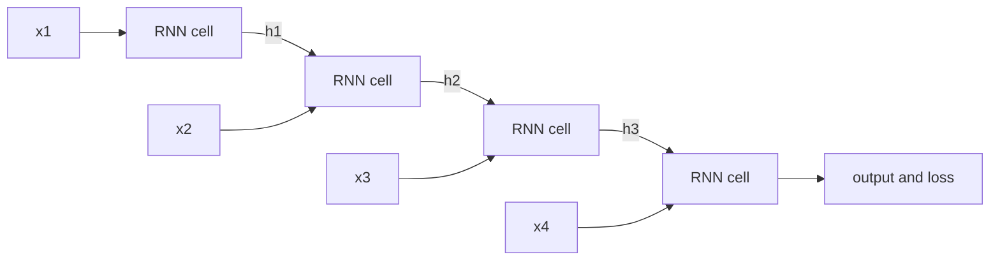

**In simple words:** RNN sequence ko ek ek step mein padhta hai aur memory (hidden state) rakhta hai. Ise train karne ke liye error ko saare time steps se peeche bheja jaata hai; ise **backpropagation through time (BPTT)** kehte hain. <Cite id="class-dl-chp5" loc="slide 10" />

**Definition:** RNN ek neural network hai jisme hidden states hote hain aur pichhle outputs ko inputs ki tarah use kiya ja sakta hai. Ye sequential data ke liye bana hai. <Cite id="class-dl-m5" loc="p. 9" />

**Architecture:** har time step par wahi cell **wahi weights** ke saath use hota hai, isliye parameters kam hote hain aur kisi bhi length ki sequence handle hoti hai. Step $t$ par ye current input $x_t$ aur previous hidden state $h_{t-1}$ leta hai aur naya hidden state $h_t$ aur output deta hai. <Cite id="class-dl-chp5" loc="slide 7" /> <Cite id="class-dl-m5" loc="p. 8" />

**Equations:** $h_t = \tanh(U x_t + W h_{t-1} + b)$ aur $\hat{y}_t = \text{softmax}(V h_t + c)$. Yahan $U$ input weight, $W$ hidden-to-hidden weight, $V$ output weight, aur $b$, $c$ biases hain; ye sab har step par same hain. <Cite id="class-dl-chp5" loc="slide 7" />

**BPTT se training:** BPTT backpropagation hai jo alag alag time steps par lagayi jaati hai. Easy matlab: time mein aage, phir time mein peeche. <Cite id="class-dl-chp5" loc="slide 10" />

1. **Forward pass:** sequence ko word by word padho aur $h_1, h_2, \dots$ aur output nikalo.
2. **Loss calculate karo:** prediction ko target se compare karo.
3. **Backward pass:** error ko last step se pichhle step, phir uske pichhle, pehle step tak bhejo, aur $W, U, V, b, c$ ke gradients nikalo.
4. **Weights update karo** gradient descent se, aur repeat karo.

**Example:** "I love eating ___" ka target "pizza" hai. Agar RNN "apple" predict kare to loss high hota hai, BPTT error ko $h_3, h_2, h_1$ se peeche bhejta hai aur weights update hote hain; agli baar pizza 90% aata hai. <Cite id="class-dl-chp5" loc="slide 14" />

**BPTT ki problems:** lambi sequences mein gradient peeche jaate hue baar baar multiply hota hai. Ya to wo vanish ho jaata hai (bahut chhota, shuru ke steps kuch nahi seekhte, long-term dependencies mushkil) ya explode (bahut bada, training unstable). <Cite id="class-dl-chp5" loc="slide 11" />

**Remedies:** exploding gradients ke liye gradient clipping; **truncated BPTT**, jo backpropagation ko fixed steps tak limit karta hai; aur vanishing gradients ke liye LSTM ya GRU gates. <Cite id="class-dl-chp5" loc="slide 22" /> <Cite id="class-dl-m5" loc="p. 14" />

**Conclusion:** RNN ek cell ko time mein share karta hai aur BPTT se seekhta hai, pehle time mein aage phir time mein peeche.
