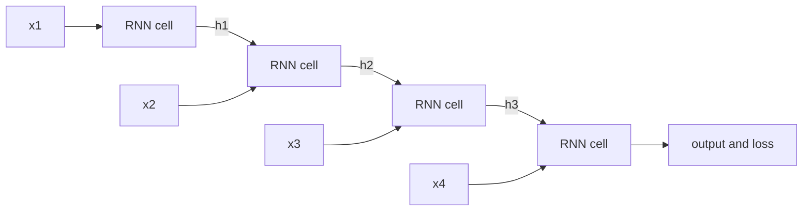

**In simple words:** an RNN reads a sequence one step at a time and keeps a memory (the hidden state). To train it, the error is sent backward through all the time steps; this is **backpropagation through time (BPTT)**. <Cite id="class-dl-chp5" loc="slide 10" />

**Definition:** an RNN is a type of neural network that has hidden states and allows past outputs to be used as inputs. It is designed for sequential data. <Cite id="class-dl-m5" loc="p. 9" />

**Architecture:** the same cell is used at every time step with **the same weights**, so the network has fewer parameters and handles sequences of any length. At step $t$ it takes the current input $x_t$ and the previous hidden state $h_{t-1}$ and gives a new hidden state $h_t$ and an output. <Cite id="class-dl-chp5" loc="slide 7" /> <Cite id="class-dl-m5" loc="p. 8" />

**Equations:** $h_t = \tanh(U x_t + W h_{t-1} + b)$ and $\hat{y}_t = \text{softmax}(V h_t + c)$. Here $U$ is the input weight, $W$ the hidden-to-hidden weight, $V$ the output weight, and $b$, $c$ the biases; all are the same at every step. <Cite id="class-dl-chp5" loc="slide 7" />

**Training with BPTT:** BPTT is backpropagation applied across the different time steps. Easy meaning: forward through time, then backward through time. <Cite id="class-dl-chp5" loc="slide 10" />

1. **Forward pass:** read the sequence word by word and compute $h_1, h_2, \dots$ and the output.
2. **Calculate the loss:** compare the prediction with the target.
3. **Backward pass:** send the error back through the last step, then the one before, down to the first step, finding the gradients for $W, U, V, b, c$.
4. **Update the weights** with gradient descent, and repeat.

**Example:** for "I love eating ___" the target is "pizza". If the RNN predicts "apple", the loss is high, BPTT sends the error back through $h_3, h_2, h_1$ and the weights are updated; the next try gives pizza 90%. <Cite id="class-dl-chp5" loc="slide 14" />

**Problems of BPTT:** on long sequences the gradient is multiplied again and again as it travels back. It either vanishes (very small, early steps learn almost nothing, long-term dependencies are hard) or explodes (very large, unstable training). <Cite id="class-dl-chp5" loc="slide 11" />

**Remedies:** gradient clipping for exploding gradients; **truncated BPTT**, which limits backpropagation to a fixed number of steps; and LSTM or GRU gates for vanishing gradients. <Cite id="class-dl-chp5" loc="slide 22" /> <Cite id="class-dl-m5" loc="p. 14" />

**Conclusion:** an RNN shares one cell across time and learns by BPTT, forward through time and then backward through time.
