**In simple words:** AlexNet wo CNN hai jisne 2012 ka ImageNet competition jeeta. Isne dikhaya ki GPUs par ReLU aur dropout ke saath train kiya gaya deep CNN image features khud seekh sakta hai. <Cite id="class-dl-chp4" loc="slide 46" />

**Definition:** AlexNet ek deep CNN architecture hai jo 2012 mein ImageNet image classification mein shaandar performance se landmark ban gaya. Ise Krizhevsky, Sutskever aur Hinton ne banaya. <Cite id="class-dl-chp4" loc="slide 46" />

**Architecture** <Cite id="class-dl-m4" loc="p. 57" /> <Cite id="class-dl-m4" loc="p. 58" />

```mermaid
%% caption: AlexNet: paanch convolution layers (pooling 1, 2 aur 5 ke baad) aur teen fully connected layers.
flowchart LR
  A["Input 227×227×3"] --> B["Conv1 96 filters 11×11, s4 → 55×55×96"]
  B --> C["Pool → 27×27×96"]
  C --> D["Conv2 256, 5×5 → 27×27×256"]
  D --> E["Pool → 13×13×256"]
  E --> F["Conv3, Conv4 384, Conv5 256 → 13×13×256"]
  F --> G["Pool → 6×6×256"]
  G --> H["FC6 4096, FC7 4096 (dropout 0.5)"]
  H --> I["FC8 1000 + softmax"]
```

- **8 learnable layers:** 5 convolutional aur 3 fully connected. Output layer (softmax) ko chhodkar har layer ke baad ReLU hai.
- Output size $= \lfloor (N + 2P - F)/S \rfloor + 1$, jaise $(227 - 11)/4 + 1 = 55$.
- Depth ke saath filters badhte hain (96, 256, 384, 384, 256) aur filter size ghatta hai (11, 5, 3, 3, 3), isliye deeper layers complex features seekhti hain. Pooling size kam karta hai, depth nahi.
- Lagbhag 62 million parameters, zyadatar fully connected layers mein.

**ReLU ka significance** <Cite id="class-dl-m4" loc="p. 55" />

- ReLU $\max(0, x)$ hai: simple, calculate karne mein fast aur gradient mein sasta. AlexNet ne tanh ki jagah ise use kiya aur training lagbhag **6 guna tez** ho gayi.
- Ispar sigmoid ya tanh ke muqable vanishing gradient problem ka asar kam hota hai, isliye aath layers mein gradients healthy rehte hain. <Cite id="class-dl-chp2" loc="slide 65" />

**Dropout ka significance** <Cite id="class-dl-m4" loc="p. 55" />

- AlexNet mein lagbhag 60 million parameters hain, isliye wo training images ko aasani se ratta maar sakta hai (overfitting).
- Dropout training mein fully connected layers ke random neurons (probability 0.5) off kar deta hai; wo forward propagation ya weight updates mein hissa nahi lete. Neurons ek doosre par depend nahi karte aur general features seekhte hain, isliye overfitting kam hoti hai. Test time par sab neurons use hote hain. <Cite id="class-dl-chp2" loc="slide 108" />
- Isi wajah se data augmentation bhi use hua.

**Conclusion:** ReLU ne deep network ko tez train kiya aur dropout ne generalize karaya; GPUs aur big data ke saath AlexNet ne state-of-the-art image classification diya. <Cite id="class-dl-chp4" loc="slide 46" />
