**In simple words:** AlexNet is the CNN that won the 2012 ImageNet competition. It showed that a deep CNN trained on GPUs with ReLU and dropout can learn image features by itself. <Cite id="class-dl-chp4" loc="slide 46" />

**Definition:** AlexNet is a deep CNN architecture that became a landmark in 2012 by achieving outstanding ImageNet image-classification performance. It was developed by Krizhevsky, Sutskever and Hinton. <Cite id="class-dl-chp4" loc="slide 46" />

**Architecture** <Cite id="class-dl-m4" loc="p. 57" /> <Cite id="class-dl-m4" loc="p. 58" />

```mermaid
%% caption: AlexNet: five convolution layers (max pooling after 1, 2 and 5) and three fully connected layers.
flowchart LR
  A["Input 227×227×3"] --> B["Conv1 96 filters 11×11, s4 → 55×55×96"]
  B --> C["Pool → 27×27×96"]
  C --> D["Conv2 256, 5×5 → 27×27×256"]
  D --> E["Pool → 13×13×256"]
  E --> F["Conv3, Conv4 384, Conv5 256 → 13×13×256"]
  F --> G["Pool → 6×6×256"]
  G --> H["FC6 4096, FC7 4096 (dropout 0.5)"]
  H --> I["FC8 1000 + softmax"]
```

- **8 learnable layers:** 5 convolutional and 3 fully connected. ReLU follows every layer except the output (softmax).
- Output size $= \lfloor (N + 2P - F)/S \rfloor + 1$, for example $(227 - 11)/4 + 1 = 55$.
- The number of filters grows with depth (96, 256, 384, 384, 256) and the filter size falls (11, 5, 3, 3, 3), so deeper layers learn more complex features. Pooling reduces size, not depth.
- About 62 million parameters, most in the fully connected layers.

**Significance of ReLU** <Cite id="class-dl-m4" loc="p. 55" />

- ReLU is $\max(0, x)$: simple, fast to compute and cheap in the gradient. AlexNet used it instead of tanh, and training became almost **six times faster**.
- It is less affected by the vanishing gradient problem than sigmoid or tanh, so the gradients stay healthy through the eight layers. <Cite id="class-dl-chp2" loc="slide 65" />

**Significance of Dropout** <Cite id="class-dl-m4" loc="p. 55" />

- AlexNet has about 60 million parameters, so it can easily memorize the training images (overfitting).
- Dropout randomly switches off neurons (probability 0.5) in the fully connected layers during training; they take no part in forward propagation or weight updates. Neurons cannot depend on each other and learn general features, so overfitting reduces. All neurons are used at test time. <Cite id="class-dl-chp2" loc="slide 108" />
- Data augmentation was also used for the same reason.

**Conclusion:** ReLU made the deep network train fast and dropout made it generalize; with GPUs and big data, AlexNet gave state-of-the-art image classification. <Cite id="class-dl-chp4" loc="slide 46" />
