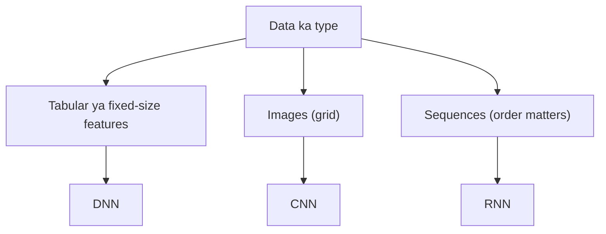

**In simple words:** DNN general fully connected network hai jo normal (tabular) data ke liye hai, CNN images aur grid-like data ke liye bana hai, aur RNN us data ke liye jo order mein aata hai. Har network ka structure usi data ke hisaab se hai jo wo handle karta hai.

| Aspect | DNN | CNN | RNN |
|---|---|---|---|
| Data handled | Tabular data aur fixed-size inputs <Cite id="class-dl-chp4" loc="slide 67" /> | Images aur doosra grid-like data <Cite id="class-dl-chp4" loc="slide 5" /> | Sequential data: text, speech, time series <Cite id="class-dl-chp5" loc="slide 5" /> |
| Structure | Ek input layer, do ya zyada hidden layers, ek output layer; har neuron agli layer se jura <Cite id="class-dl-chp2" loc="slide 2" /> | Convolution + pooling layers (chhote filters), phir flatten aur fully connected layers <Cite id="class-dl-chp4" loc="slide 28" /> | Hidden state wala cell jo wapas feed hota hai; har time step par wahi cell aur weights <Cite id="class-dl-m5" loc="p. 12" /> |
| Connections | Dense, loop nahi | Local connections, shared filter weights | Time mein feedback loop |
| Memory | Nahi | Nahi (spatial pattern dekhta hai) | Pichhle inputs yaad rakhta hai |
| Parameters | Images ke liye bahut zyada | Bahut kam, weight sharing ki wajah se | Kam, kyunki weights time mein shared hain |
| Training | Backpropagation | Backpropagation | Backpropagation through time (BPTT) |
| Main problem | Spatial structure kho deta hai; images ke liye bahut parameters | Image-like data chahiye | Lambi sequences par vanishing aur exploding gradients |
| Applications | Tabular data se prediction, classification | Image classification, face recognition, object detection, medical images <Cite id="class-dl-chp4" loc="slide 67" /> | Speech recognition, translation, sentiment analysis, next-word prediction <Cite id="class-dl-chp5" loc="slide 13" /> |

**Conclusion:** tabular data ke liye DNN, images ke liye CNN aur sequences ke liye RNN (ya LSTM) chuno.
