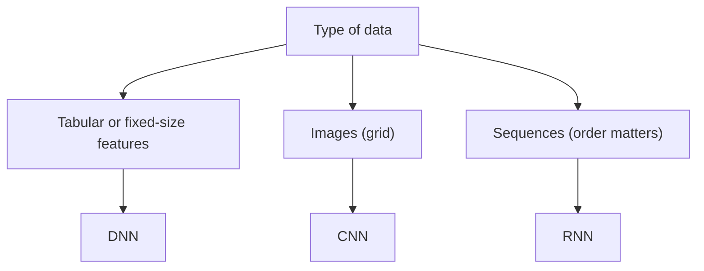

**In simple words:** a DNN is the general fully connected network for ordinary (tabular) data, a CNN is built for images and grid-like data, and an RNN is built for data that comes in order. The structure of each one matches the data it handles.

| Aspect | DNN | CNN | RNN |
|---|---|---|---|
| Data handled | Tabular data and fixed-size inputs <Cite id="class-dl-chp4" loc="slide 67" /> | Images and other grid-like data <Cite id="class-dl-chp4" loc="slide 5" /> | Sequential data: text, speech, time series <Cite id="class-dl-chp5" loc="slide 5" /> |
| Structure | One input layer, two or more hidden layers, one output layer; every neuron connects to the next layer <Cite id="class-dl-chp2" loc="slide 2" /> | Convolution + pooling layers (small filters), then flatten and fully connected layers <Cite id="class-dl-chp4" loc="slide 28" /> | A cell with a hidden state that is fed back; the same cell and weights at every time step <Cite id="class-dl-m5" loc="p. 12" /> |
| Connections | Dense, no loop | Local connections, shared filter weights | Feedback loop through time |
| Memory | None | None (looks at the spatial pattern) | Remembers earlier inputs |
| Parameters | Very many for images | Far fewer, because of weight sharing | Few, because weights are shared across time |
| Training | Backpropagation | Backpropagation | Backpropagation through time (BPTT) |
| Main problem | Loses spatial structure; too many parameters for images | Needs image-like data | Vanishing and exploding gradients on long sequences |
| Applications | Prediction from tabular data, classification | Image classification, face recognition, object detection, medical images <Cite id="class-dl-chp4" loc="slide 67" /> | Speech recognition, translation, sentiment analysis, next-word prediction <Cite id="class-dl-chp5" loc="slide 13" /> |

**Conclusion:** choose DNN for tabular data, CNN for images and RNN (or LSTM) for sequences.
