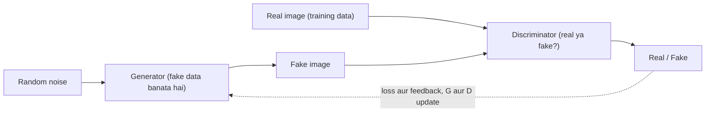

**In simple words:** GAN do neural networks se bana hai jo ek doosre ke against kaam karte hain. Generator random noise se fake data banata hai aur discriminator check karta hai ki data real hai ya fake. Competition se dono improve hote hain. <Cite id="class-dl-chp6" loc="slide 3" />

**Definition:** Generative Adversarial Network (GAN) ek deep learning model hai jo naya data generate karta hai jo real training data jaisa dikhta hai. <Cite id="class-dl-chp6" loc="slide 3" />

**Components** <Cite id="class-dl-chp6" loc="slide 9" />

- **Random noise:** random numbers ka vector; sirf starting point. Alag noise se alag images milti hain. <Cite id="class-dl-chp6" loc="slide 8" />
- **Generator (G):** input random noise, output generated image. Iska goal discriminator ko dhokha dene layak real dikhna hai (jaise artist realistic painting banata hai).
- **Discriminator (D):** input real ya generated image, output REAL ya FAKE. Iska goal dono ko alag pehchanna hai (jaise art critic).

**Working principle (competition)** <Cite id="class-dl-chp6" loc="slides 6, 10 and 11" />

1. Generator random noise se fake image banata hai.
2. Discriminator real aur fake samples check karke real ya fake batata hai.
3. Loss calculate hota hai aur backpropagation feedback deta hai.
4. Dono networks apne parameters update karte hain: discriminator behtar judge, generator behtar forger banta hai.
5. Tab tak repeat jab tak generator realistic images na banaye aur discriminator farq na bata paye.
6. Training ke baad sirf generator use hota hai, naye random noise ke saath.

**Problems:** training unstable ho sakti hai, aur mode collapse ho sakta hai, jisme generator sirf kuch milte-julte outputs banata rehta hai. <Cite id="class-dl-chp6" loc="slide 13" />

**Applications:** image generation, image-to-image translation, super-resolution, image restoration, synthetic data. <Cite id="class-dl-chp6" loc="slide 16" />

**Conclusion:** GAN apne generator aur discriminator ke competition se realistic data generate karna seekhta hai.
