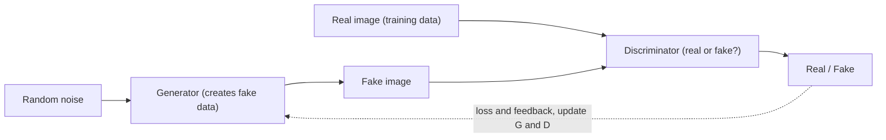

**In simple words:** a GAN is built from two neural networks that work against each other. A generator creates fake data from random noise and a discriminator checks whether data is real or fake. Both improve by competing. <Cite id="class-dl-chp6" loc="slide 3" />

**Definition:** a Generative Adversarial Network (GAN) is a deep learning model used to generate new data that looks similar to real training data. <Cite id="class-dl-chp6" loc="slide 3" />

**Components** <Cite id="class-dl-chp6" loc="slide 9" />

- **Random noise:** a vector of random numbers; only a starting point. Different noise gives different images. <Cite id="class-dl-chp6" loc="slide 8" />
- **Generator (G):** input random noise, output a generated image. Its goal is to look real enough to fool the discriminator (like an artist making a realistic painting).
- **Discriminator (D):** input a real image or a generated one, output REAL or FAKE. Its goal is to tell them apart (like an art critic).

**Working principle (the competition)** <Cite id="class-dl-chp6" loc="slides 6, 10 and 11" />

1. The generator makes a fake image from random noise.
2. The discriminator checks real and fake samples and says real or fake.
3. The loss is calculated and backpropagation gives feedback.
4. Both networks update their parameters: the discriminator becomes a better judge, the generator a better forger.
5. Repeat until the generator makes realistic images and the discriminator can no longer tell the difference.
6. After training, only the generator is used, with new random noise.

**Problems:** training can be unstable, and mode collapse can occur, where the generator keeps making only a few similar outputs. <Cite id="class-dl-chp6" loc="slide 13" />

**Applications:** image generation, image-to-image translation, super-resolution, image restoration, synthetic data. <Cite id="class-dl-chp6" loc="slide 16" />

**Conclusion:** a GAN learns to generate realistic data through the competition between its generator and discriminator.
