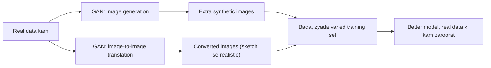

**In simple words:** GAN naye images bana sakta hai jo real dikhte hain, isliye jis model ke paas real data kam hai wo zyada examples par train ho sakta hai. Image generation mein GAN nayi pictures banata hai; image-to-image translation mein wo ek tarah ki picture ko doosri tarah ki picture mein badalta hai. Class kehti hai ki GAN data training mein madad karta hai kyunki bade real data ki zaroorat kam ho jaati hai. <Cite id="class-dl-chp6" loc="slide 22" />

**1. Image generation** <Cite id="class-dl-chp6" loc="slide 16" />

- Generator random noise se naye human faces, objects, animals ya scenery banata hai.
- **Training efficiency ke liye:** GAN ko kuch real images (jaise 500) par train karo, phir generator se bahut saari aur banao. Real plus synthetic images se bada aur zyada diverse training set milta hai, jo model performance badhata hai aur real data par dependency kam karta hai. <Cite id="class-dl-chp6" loc="slide 22" />
- Use se pehle synthetic images ki quality check karo, kyunki kuch unnatural dikhti hain. Medical imaging mein ye research aur augmentation ke liye hain, diagnosis ke liye nahi. <Cite id="class-dl-chp6" loc="slide 25" />

**2. Image-to-image translation** <Cite id="class-dl-chp6" loc="slide 19" />

- GAN source domain (sketch) se target domain (realistic image) ka mapping seekhta hai; doosre examples day to night aur summer to winter hain.
- Generator sketch ko convert karta hai; discriminator check karta hai ki result real target-domain image jaisa dikhta hai ya nahi; loss feedback deta hai aur generator tab tak improve hota hai jab tak output real na lage.
- **Training efficiency ke liye:** ek tarah ki image ko doosri tarah ki image mein badla ja sakta hai, isliye jin examples ko jama karna mushkil hai unhe aasani se milne wale examples se banaya ja sakta hai.

**Related uses:** super-resolution (low se high resolution) aur image restoration (noise hatao, missing parts bharo) kharab images ko training ke layak banate hain. <Cite id="class-dl-chp6" loc="slide 16" />

**Limits:** class ye nahi kehti ki GAN training ko khud tez banata hai; fayda zyada aur behtar data ka hai. GAN training unstable ho sakti hai aur mode collapse ho sakta hai, aur wahi technology deepfakes bhi banati hai. <Cite id="class-dl-chp6" loc="slide 13" /> <Cite id="class-dl-chp6" loc="slide 14" />

**Conclusion:** image generation zyada samples jodti hai aur image-to-image translation aasani se milne wali images ko zaroorat wali kism mein badalti hai, isliye model kam real data se train hota hai.
