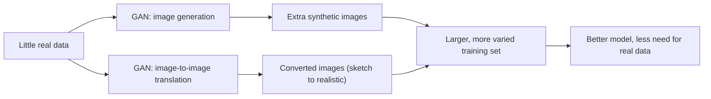

**In simple words:** a GAN can make new images that look real, so a model that has little real data can train on more examples. In image generation the GAN creates the new pictures; in image-to-image translation it converts a picture from one kind into another. The class says GAN data helps training because it reduces the need for large amounts of real data. <Cite id="class-dl-chp6" loc="slide 22" />

**1. Image generation** <Cite id="class-dl-chp6" loc="slide 16" />

- The generator makes new human faces, objects, animals or scenery from random noise.
- **For training efficiency:** train the GAN on the few real images (for example 500), then use the generator to make many more. Real plus synthetic images give a larger and more diverse training set, which improves model performance and reduces the dependency on real data. <Cite id="class-dl-chp6" loc="slide 22" />
- Check the quality of the synthetic images before use, because some look unnatural. In medical imaging they are for research and augmentation, not diagnosis. <Cite id="class-dl-chp6" loc="slide 25" />

**2. Image-to-image translation** <Cite id="class-dl-chp6" loc="slide 19" />

- The GAN learns a mapping from a source domain (a sketch) to a target domain (a realistic image); other examples are day to night and summer to winter.
- The generator converts the sketch; the discriminator checks whether the result looks like a real target-domain image; the loss gives feedback and the generator improves until the output looks real.
- **For training efficiency:** one kind of image can be turned into another, so examples that are hard to collect can be produced from ones that are easy to get.

**Related uses:** super-resolution (low to high resolution) and image restoration (remove noise, fill missing parts) make poor images usable for training. <Cite id="class-dl-chp6" loc="slide 16" />

**Limits:** the class does not say GANs make training itself faster; the benefit is more and better data. GAN training can be unstable and suffer mode collapse, and the same technology allows deepfakes. <Cite id="class-dl-chp6" loc="slide 13" /> <Cite id="class-dl-chp6" loc="slide 14" />

**Conclusion:** image generation adds more samples and image-to-image translation converts easy-to-get images into the needed kind, so the model trains with less real data.
