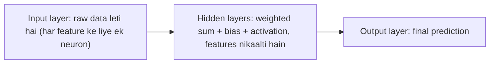

**In simple words:** feedforward network data ko teen tarah ki layers se ek hi direction mein guzaarta hai. Input layer data leti hai, hidden layers patterns dhoondhti hain, aur output layer answer deti hai. <Cite id="class-dl-chp1" loc="slide 28" />

**Definition:** feedforward neural network ek aisa neural network hai jismein data sirf ek direction mein jaata hai, input layer se output layer tak. Network mein koi feedback ya loop nahi hota. <Cite id="class-dl-chp1" loc="slide 28" />

**Har layer ka role** <Cite id="class-dl-m1" loc="p. 17" /> <Cite id="class-dl-chp1" loc="slide 22" />

| Layer | Role |
|---|---|
| Input layer | Input leti hai; har neuron ek input feature ke liye hota hai (teen features to teen neurons). Ye koi calculation nahi karti. |
| Hidden layer(s) | Input layer ki information process karti hain; calculate karke important patterns seekhti hain. Zyada hidden layers zyada complex patterns seekhti hain. |
| Output layer | Final prediction ya result deti hai; multiple outputs ho to utne neurons. |

**Working, step by step:** input, input layer ko diya jaata hai; inputs weights se multiply hote hain; bias add hota hai; activation function lagta hai; output agli layer ko jaata hai; final output milta hai. Har neuron ke liye $z = \sum_i w_ix_i + b$ aur $a = f(z)$. <Cite id="class-dl-chp1" loc="slide 28" />

**Learning:** output ko actual output se compare karte hain, error backpropagation se network mein peeche bheja jaata hai aur weights adjust hote hain, jab tak error minimum na ho. <Cite id="class-dl-chp1" loc="slide 11" />

**Conclusion:** har layer ka apna kaam hai, aur saath milkar wo raw input ko prediction mein badalti hain.
