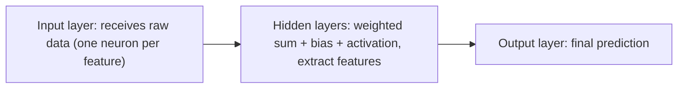

**In simple words:** a feedforward network passes data through three kinds of layers in one direction. The input layer takes the data, the hidden layers find patterns, and the output layer gives the answer. <Cite id="class-dl-chp1" loc="slide 28" />

**Definition:** a feedforward neural network is a type of neural network where data moves only in one direction, from the input layer to the output layer. There is no feedback or loop in the network. <Cite id="class-dl-chp1" loc="slide 28" />

**Role of each layer** <Cite id="class-dl-m1" loc="p. 17" /> <Cite id="class-dl-chp1" loc="slide 22" />

| Layer | Role |
|---|---|
| Input layer | Takes the input; each neuron corresponds to an input feature (three features means three neurons). It does no calculation. |
| Hidden layer(s) | Process the information from the input layer; calculate and learn important patterns. More hidden layers learn more complex patterns. |
| Output layer | Generates the final prediction or result; with multiple outputs it has that many neurons. |

**Working, step by step:** input is given to the input layer; inputs are multiplied with weights; bias is added; the activation function is applied; the output is passed to the next layer; the final output is produced. For each neuron $z = \sum_i w_ix_i + b$ and $a = f(z)$. <Cite id="class-dl-chp1" loc="slide 28" />

**Learning:** the output is compared with the actual output, the error is sent back through the network by backpropagation and the weights are adjusted, repeating until the error is minimum. <Cite id="class-dl-chp1" loc="slide 11" />

**Conclusion:** every layer has its own job, and together they turn raw input into a prediction.
