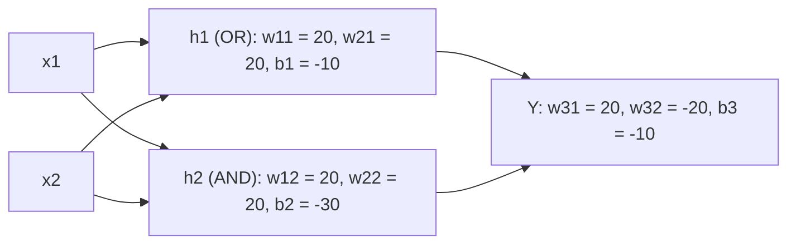

**In simple words:** XOR ko ek perceptron solve nahi kar sakta kyunki ek seedhi line uske points ko alag nahi kar sakti. Hidden layer wala multi-layer perceptron ise solve karta hai: hidden neurons OR aur AND nikaalte hain, aur output neuron kehta hai "OR but not AND". <Cite id="class-dl-chp1" loc="slide 23" />

**Problem:** XOR tab 1 deta hai jab exactly ek input 1 ho.

| $x_1$ | $x_2$ | Target $Y$ |
|---|---|---|
| 0 | 0 | 0 |
| 0 | 1 | 1 |
| 1 | 0 | 1 |
| 1 | 1 | 0 |

**Ek perceptron kyun fail hota hai:** points (0,1) aur (1,0) class 1 hain aur (0,0) aur (1,1) class 0; seedhi line kaise bhi kheencho, ek point galat classify hota hai. XOR linearly separable nahi hai. <Cite id="class-dl-m1" loc="p. 6" />

**Design (step by step).** Do inputs lo, do neurons ki hidden layer jodo, unhe weights aur biases se connect karo, hidden neurons ko output neuron $Y$ se jodo, aur hidden aur output layers mein sigmoid (ya step) activation use karo. <Cite id="class-dl-chp1" loc="slide 24" />

<Sum>

<Given>

sigmoid neurons wala 2-2-1 network: $w_{11} = w_{21} = 20$, $b_1 = -10$; $w_{12} = w_{22} = 20$, $b_2 = -30$; $w_{31} = 20$, $w_{32} = -20$, $b_3 = -10$.

</Given>

<Find>

har input pair ke liye output $Y$.

</Find>

<Steps>

1. **Hidden neuron 1:** $z_1 = 20x_1 + 20x_2 - 10$. Inputs (0,0), (0,1), (1,0), (1,1) ke liye ye $-10, 10, 10, 30$ hai, isliye $h_1 \approx 0, 1, 1, 1$ (OR neuron).
2. **Hidden neuron 2:** $z_2 = 20x_1 + 20x_2 - 30$. Ye $-30, -10, -10, 10$ hai, isliye $h_2 \approx 0, 0, 0, 1$ (AND neuron).
3. **Output neuron:** $z_3 = 20h_1 - 20h_2 - 10$. Ye $-10, 10, 10, -10$ hai.
4. **Sigmoid lagao:** $\sigma(-10) \approx 0.00005 \approx 0$ aur $\sigma(10) \approx 0.99995 \approx 1$.

</Steps>

<Answer>

(0,0), (0,1), (1,0), (1,1) ke liye $Y = 0, 1, 1, 0$: XOR truth table.

</Answer>

<Box kind="verify">

(1,1) check karo: $h_1 = 1$ aur $h_2 = 1$, isliye $z_3 = 20 - 20 - 10 = -10$ aur $Y \approx 0$, XOR ke liye sahi. (0,1) check karo: $h_1 = 1$, $h_2 = 0$, isliye $z_3 = 20 - 0 - 10 = 10$ aur $Y \approx 1$, sahi.

</Box>

</Sum>

| $x_1$ | $x_2$ | $h_1$ | $h_2$ | $Y$ |
|---|---|---|---|---|
| 0 | 0 | low | low | 0 |
| 0 | 1 | high | low | 1 |
| 1 | 0 | high | low | 1 |
| 1 | 1 | high | high | 0 |

**Conclusion:** XOR ko 2-2-1 MLP se implement kar sakte hain kyunki hidden layer non-linear decision boundary banati hai, jo single-layer perceptron nahi kar sakta. <Cite id="class-dl-chp1" loc="slide 24" />
