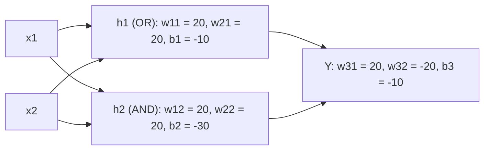

**In simple words:** XOR cannot be solved by one perceptron because one straight line cannot separate its points. A multi-layer perceptron with a hidden layer solves it: the hidden neurons compute OR and AND, and the output neuron says "OR but not AND". <Cite id="class-dl-chp1" loc="slide 23" />

**Problem:** XOR gives 1 when exactly one input is 1.

| $x_1$ | $x_2$ | Target $Y$ |
|---|---|---|
| 0 | 0 | 0 |
| 0 | 1 | 1 |
| 1 | 0 | 1 |
| 1 | 1 | 0 |

**Why one perceptron fails:** the points (0,1) and (1,0) are class 1 and (0,0) and (1,1) are class 0; however a straight line is drawn, one point is misclassified. XOR is not linearly separable. <Cite id="class-dl-m1" loc="p. 6" />

**Design (step by step).** Take two inputs, add a hidden layer of two neurons, connect them with weights and biases, connect the hidden neurons to the output neuron $Y$, and use a sigmoid (or step) activation in the hidden and output layers. <Cite id="class-dl-chp1" loc="slide 24" />

<Sum>

<Given>

a 2-2-1 network with sigmoid neurons: $w_{11} = w_{21} = 20$, $b_1 = -10$; $w_{12} = w_{22} = 20$, $b_2 = -30$; $w_{31} = 20$, $w_{32} = -20$, $b_3 = -10$.

</Given>

<Find>

the output $Y$ for each input pair.

</Find>

<Steps>

1. **Hidden neuron 1:** $z_1 = 20x_1 + 20x_2 - 10$. This is $-10, 10, 10, 30$ for the inputs (0,0), (0,1), (1,0), (1,1), so $h_1 \approx 0, 1, 1, 1$ (an OR neuron).
2. **Hidden neuron 2:** $z_2 = 20x_1 + 20x_2 - 30$. This is $-30, -10, -10, 10$, so $h_2 \approx 0, 0, 0, 1$ (an AND neuron).
3. **Output neuron:** $z_3 = 20h_1 - 20h_2 - 10$. This is $-10, 10, 10, -10$.
4. **Apply the sigmoid:** $\sigma(-10) \approx 0.00005 \approx 0$ and $\sigma(10) \approx 0.99995 \approx 1$.

</Steps>

<Answer>

$Y = 0, 1, 1, 0$ for (0,0), (0,1), (1,0), (1,1): the XOR truth table.

</Answer>

<Box kind="verify">

Check (1,1): $h_1 = 1$ and $h_2 = 1$, so $z_3 = 20 - 20 - 10 = -10$ and $Y \approx 0$, correct for XOR. Check (0,1): $h_1 = 1$, $h_2 = 0$, so $z_3 = 20 - 0 - 10 = 10$ and $Y \approx 1$, correct.

</Box>

</Sum>

| $x_1$ | $x_2$ | $h_1$ | $h_2$ | $Y$ |
|---|---|---|---|---|
| 0 | 0 | low | low | 0 |
| 0 | 1 | high | low | 1 |
| 1 | 0 | high | low | 1 |
| 1 | 1 | high | high | 0 |

**Conclusion:** XOR can be implemented using a 2-2-1 MLP because the hidden layer creates a non-linear decision boundary, which a single-layer perceptron cannot do. <Cite id="class-dl-chp1" loc="slide 24" />
