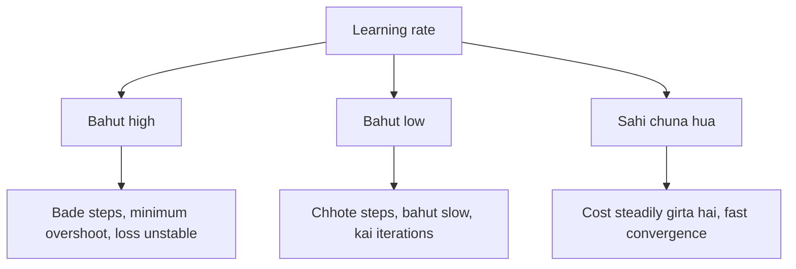

**In simple words:** loss function ek training example ka error naapta hai; cost function poore training set par un errors ka average hai. Learning rate decide karta hai ki network us error ko kam karte waqt kitna bada step leta hai. <Cite id="class-dl-m1" loc="p. 28" />

**Loss function aur cost function mein difference.** Dono terms synonymous maane jaate hain, lekin ek chhota difference hai. <Cite id="class-dl-m1" loc="p. 28" />

| | Loss function | Cost function |
|---|---|---|
| Kiska error naapta hai | Ek training example | Poora training set (average error) |
| Example | Ek fruit ke liye $\lvert 185 - 180 \rvert = 5$ g | Saare fruits par aise losses ka mean |
| Link | Cost function = loss (jaise binary cross entropy) + regularization term <Cite id="class-dl-m2" loc="p. 32" /> | |

Dono actual $y$ aur predicted $y$ ka difference naapte hain aur model ko feedback dete hain taaki wo parameters adjust kare, negative gradient ki direction mein tab tak chalte hue jab tak cost zero ke paas na pahunch jaaye. <Cite id="class-dl-m1" loc="p. 28" />

**Learning rate** (step size ya alpha bhi kehte hain) wo step ka size hai jo minimum tak pahunchne ke liye liya jaata hai. Ye aam taur par chhoti value hoti hai. <Cite id="class-dl-m1" loc="p. 29" />

| Learning rate | Training par effect |
|---|---|
| High | Bade steps, shuru mein tez, lekin minimum ko overshoot karne ka risk; loss idhar-udhar uchhal sakta hai. |
| Low | Chhote steps aur zyada precision, lekin bahut iterations: slow aur time aur computation mein mehenga. |
| Right (good) | Faster learning aur convergence. |

<Cite id="class-dl-m1" loc="p. 29" /> <Cite id="class-dl-chp2" loc="slide 8" />

Aam taur par, learning rate jitna high, model utna tez seekh sakta hai lekin final weights non-optimal reh sakte hain; low learning rate se model zyada optimal weights seekh sakta hai lekin kaafi time lag sakta hai. <Cite id="class-dl-m1" loc="p. 35" />

**Conclusion:** loss per example hai, cost dataset ka average hai, aur sahi chuna hua learning rate fast aur stable training deta hai.
