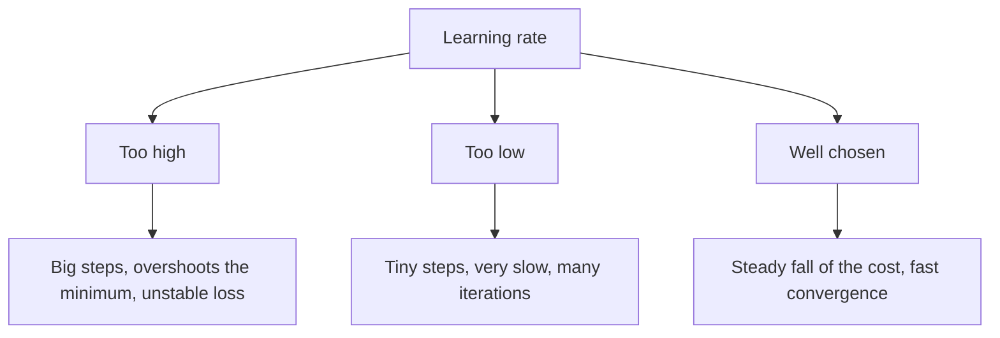

**In simple words:** the loss function measures the error for one training example; the cost function is the average of those errors over the whole training set. The learning rate decides how big a step the network takes when it reduces that error. <Cite id="class-dl-m1" loc="p. 28" />

**Difference between loss function and cost function.** The two terms are considered synonymous, but there is a slight difference. <Cite id="class-dl-m1" loc="p. 28" />

| | Loss function | Cost function |
|---|---|---|
| Measures the error of | One training example | The whole training set (average error) |
| Example | $\lvert 185 - 180 \rvert = 5$ g for one fruit | The mean of such losses over all fruits |
| Link | Cost function = loss (for example binary cross entropy) + regularization term <Cite id="class-dl-m2" loc="p. 32" /> | |

Both measure the difference between the actual $y$ and predicted $y$ and give feedback so the model can adjust its parameters, moving in the direction of the negative gradient until the cost is close to zero. <Cite id="class-dl-m1" loc="p. 28" />

**Learning rate** (also called step size or alpha) is the size of the steps taken to reach the minimum. It is typically a small value. <Cite id="class-dl-m1" loc="p. 29" />

| Learning rate | Effect on training |
|---|---|
| High | Larger steps, faster at first, but risks overshooting the minimum; the loss may bounce around. |
| Low | Small steps and more precision, but many iterations: slow and costly in time and computation. |
| Right (good) | Faster learning and convergence. |

<Cite id="class-dl-m1" loc="p. 29" /> <Cite id="class-dl-chp2" loc="slide 8" />

In general, the higher the learning rate, the faster the model can learn at the expense of a non-optimal final set of weights; with a low learning rate the model can learn a more optimal set of weights but may take considerable time. <Cite id="class-dl-m1" loc="p. 35" />

**Conclusion:** loss is per example, cost is the average over the dataset, and a well-chosen learning rate gives fast and stable training.
