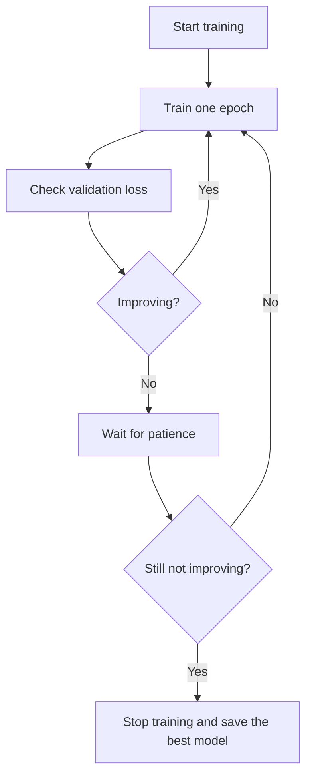

**In simple words:** network training data par 100% score karke bhi naye data par fail ho sakta hai kyunki usne seekha nahi, ratta maara. Regularization ise theek karti hai; early stopping sahi time par training rokta hai aur dropout neurons ko randomly off karta hai. <Cite id="class-dl-chp2" loc="slide 92" />

**Regularization ki zaroorat.** Model training data ko noise samet bahut achhe se seekh leta hai (overfitting): training accuracy bahut high aur testing accuracy low, to unseen data par poor performance. Causes: complex model, zyada epochs, chhota dataset aur noise. Zyada epochs se help nahi hoti kyunki model ratta maarne lagta hai. Regularization model ki complexity control karti hai (**Total Loss = Prediction Error + Regularization Penalty**) taaki wo better generalize kare. <Cite id="class-dl-chp2" loc="slides 93 and 97" />

**Early stopping.** Ye tab training automatically rok deta hai jab model validation data par improve hona band kar de. Har epoch ke baad validation loss check hota hai; agar kai epochs (patience) tak improve na ho to training ruk jaati hai aur best model save hota hai. To model data ratta nahi maarta aur overfitting kam hoti hai. <Cite id="class-dl-chp2" loc="slides 113 and 114" />

**Dropout.** Ye training mein kuch neurons ko randomly OFF karta hai; wo forward propagation, backpropagation ya weight updates mein hissa nahi lete, aur har iteration mein alag set drop hota hai. Neurons ek dusre par depend nahi kar sakte, to har ek independently useful patterns seekhta hai: random drop → less dependency → learn general patterns → overfitting reduces. Common rate 0.5 hai. Testing mein saare neurons active hote hain. <Cite id="class-dl-chp2" loc="slides 107 and 108" />

| | Early stopping | Dropout |
|---|---|---|
| Kya karta hai | Training jaldi rokta hai | Neurons randomly drop karta hai |
| Kaise | Validation loss monitor karta hai | Har training iteration mein kaam karta hai |
| Chahiye | Validation dataset | Extra data nahi |

**Conclusion:** dono methods model ko training data ratta maarne se rokte hain, ek sahi time par ruk kar, doosra neuron dependency tod kar.

Exam mein English mein likho: "Early stopping stops training when the validation loss stops improving; dropout randomly turns off neurons during training."
