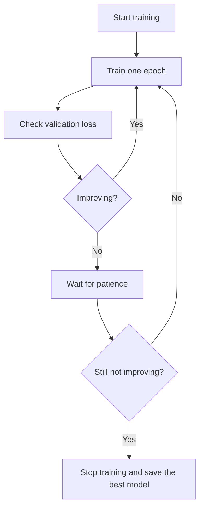

**In simple words:** a network can score 100% on its training data and still fail on new data because it memorized instead of learning. Regularization fixes this; early stopping stops training at the right time and dropout switches neurons off at random. <Cite id="class-dl-chp2" loc="slide 92" />

**Need for regularization.** The model learns the training data too well, including noise (overfitting): training accuracy is very high and testing accuracy is low, so it performs poorly on unseen data. Causes are a complex model, too many epochs, a small dataset and noise. More epochs do not help because the model starts memorizing. Regularization controls the complexity of the model (**Total Loss = Prediction Error + Regularization Penalty**) so it generalizes better. <Cite id="class-dl-chp2" loc="slides 93 and 97" />

**Early stopping.** It stops the training process automatically when the model stops improving on the validation data. The validation loss is checked after every epoch; if it does not improve for several epochs (the patience), training stops and the best model is saved. So the model does not memorize the data and overfitting is reduced. <Cite id="class-dl-chp2" loc="slides 113 and 114" />

**Dropout.** It randomly turns OFF some neurons during training; they do not take part in forward propagation, backpropagation or weight updates, and a different set is dropped in every iteration. Neurons cannot depend on each other, so each learns useful patterns independently: random drop → less dependency → learn general patterns → overfitting reduces. Common rate is 0.5. In testing all neurons are active. <Cite id="class-dl-chp2" loc="slides 107 and 108" />

| | Early stopping | Dropout |
|---|---|---|
| What it does | Stops training early | Randomly drops neurons |
| How | Monitors the validation loss | Works in each training iteration |
| Needs | A validation dataset | No extra data |

**Conclusion:** both methods stop the model from memorizing the training data, one by stopping in time, the other by breaking neuron dependency.
