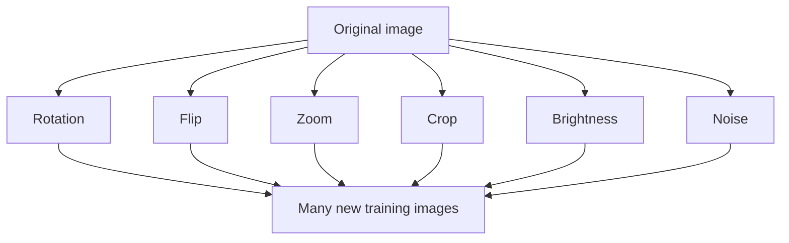

**In simple words:** data augmentation hamare paas ki kam pictures se bahut saari nayi training pictures banata hai, unhe thoda badalkar (ghumana, flip, zoom), jabki label same rehta hai. <Cite id="class-dl-chp2" loc="slide 115" />

**Definition:** data augmentation creates new training samples by modifying the existing data. The modified images still represent the same object but look different to the model. It increases the diversity of the training dataset. <Cite id="class-dl-chp2" loc="slide 115" />

**Kyun zaroori:** chhota dataset model ko object ke bajaye background, lighting aur camera angle yaad karne par majboor karta hai (overfitting). Naya data collect karna time-consuming, expensive aur kabhi impossible hai (medical images). <Cite id="class-dl-chp2" loc="slide 115" />

**Examples ke saath types (image data):** (1) **Rotation:** apple 20° rotate. (2) **Flipping:** horizontally ya vertically flip (mirrored objects). (3) **Zooming:** zoom in ya out (alag distances). (4) **Cropping:** image ka ek hissa hata diya (partially visible objects). (5) **Brightness adjustment:** brighter ya darker (alag lighting). (6) **Noise addition:** chhota random noise (noisy inputs). <Cite id="class-dl-chp2" loc="slide 116" /> Textbook colour changes, cutout / random erasing, mixup (do images aur unke labels combine) aur affine ya perspective transformations add karta hai. <Cite id="class-dl-m2" loc="p. 89" />

**Dusre data types:** **text** (synonym replacement, back translation, random insertion, deletion ya swap, BERT se contextual augmentation) aur **audio** (time stretching, pitch shifting, noise add karna, time mein shift, speed badalna). Health care data ke saath careful raho. <Cite id="class-dl-m2" loc="pp. 90-92" />

**Advantages:** bina collect kiye zyada data, kam overfitting, better generalization, robust model. **Disadvantages:** training time badhta hai, bahut zyada augmentation se accuracy ghat sakti hai, kuch changes har dataset ke liye suitable nahi. <Cite id="class-dl-chp2" loc="slide 116" />

**Conclusion:** data augmentation model ko sikhata hai ki wahi object alag dikh sakta hai, isliye wo use nayi conditions mein pehchaanta hai.

Exam mein English mein likho: "Data augmentation creates new training samples by modifying existing data, for example rotation, flipping, zooming, cropping, brightness and noise."
