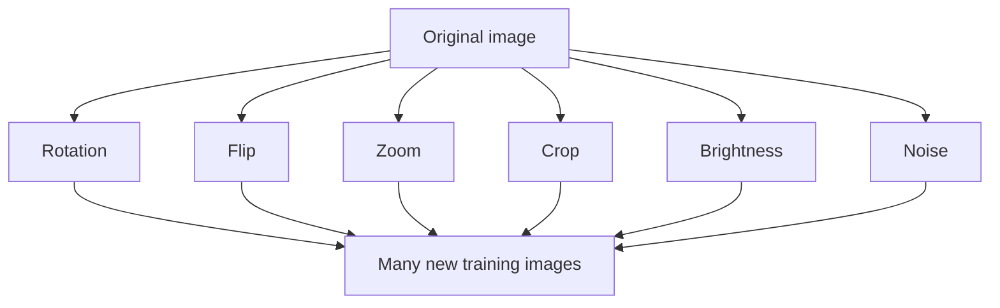

**In simple words:** data augmentation makes many new training pictures from the few we have, by changing them a little (turn, flip, zoom), while the label stays the same. <Cite id="class-dl-chp2" loc="slide 115" />

**Definition:** data augmentation creates new training samples by modifying the existing data. The modified images still represent the same object but look different to the model. It increases the diversity of the training dataset. <Cite id="class-dl-chp2" loc="slide 115" />

**Why needed:** a small dataset makes the model memorize the background, lighting and camera angle instead of the object (overfitting). Collecting new data is time-consuming, expensive and sometimes impossible (medical images). <Cite id="class-dl-chp2" loc="slide 115" />

**Types with examples (image data):** (1) **Rotation:** the apple rotated by 20°. (2) **Flipping:** flipped horizontally or vertically (mirrored objects). (3) **Zooming:** zoomed in or out (different distances). (4) **Cropping:** part of the image removed (partially visible objects). (5) **Brightness adjustment:** brighter or darker (different lighting). (6) **Noise addition:** small random noise (noisy inputs). <Cite id="class-dl-chp2" loc="slide 116" /> The textbook adds colour changes, cutout / random erasing, mixup (combine two images and their labels) and affine or perspective transformations. <Cite id="class-dl-m2" loc="p. 89" />

**Other data types:** **text** (synonym replacement, back translation, random insertion, deletion or swap, contextual augmentation with BERT) and **audio** (time stretching, pitch shifting, adding noise, shifting in time, changing speed). Be careful with health care data. <Cite id="class-dl-m2" loc="pp. 90-92" />

**Advantages:** more data without collecting it, less overfitting, better generalization, robust model. **Disadvantages:** longer training time, too much augmentation may reduce accuracy, some changes do not suit every dataset. <Cite id="class-dl-chp2" loc="slide 116" />

**Conclusion:** data augmentation teaches the model that the same object can look different, so it recognizes it in new conditions.
