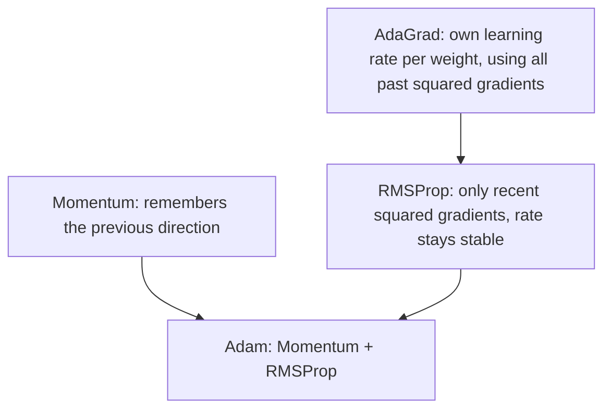

**In simple words:** AdaGrad, RMSProp aur Adam aise optimizers hain jo har weight ko apna learning rate dete hain; har ek apne se pehle wale ki ek kamzori fix karta hai. <Cite id="class-dl-chp2" loc="slide 80" />

**AdaGrad (Adaptive Gradient).** Problem: sab weights ke liye ek fixed learning rate use hota hai. AdaGrad har weight ko apna rate deta hai: aksar update hone wale weights ko chhota rate, kabhi kabhi update hone wale weights ko bada rate. $G_t = G_{t-1} + g_t^2$ aur $W_{new} = W_{old} - \dfrac{\eta}{\sqrt{G_t} + \epsilon} g_t$. **Kamzori:** ye saare past squared gradients jodta rehta hai, to learning rate lagatar ghatta hai aur lagbhag zero ho sakta hai. <Cite id="class-dl-chp2" loc="slides 80 to 82" />

**RMSProp (Root Mean Square Propagation).** Ye AdaGrad ko fix karta hai sirf recent gradients use karke, moving average ke saath: $S_t = \beta S_{t-1} + (1 - \beta) g_t^2$ aur $W_{new} = W_{old} - \dfrac{\eta}{\sqrt{S_t} + \epsilon} g_t$ ($\beta$ usually 0.9). Purane gradients ignore hote hain, to learning rate stable rehta hai. **Kamzori:** isme momentum nahi hai, aur Adam usually behtar hota hai. <Cite id="class-dl-chp2" loc="slides 83 to 85" />

**Adam (Adaptive Moment Estimation).** Adam Momentum (first moment $m_t$) aur RMSProp (second moment $v_t$) ko bias correction ke saath combine karta hai: $m_t = \beta_1 m_{t-1} + (1 - \beta_1) g_t$, $v_t = \beta_2 v_{t-1} + (1 - \beta_2) g_t^2$, $\hat m_t = m_t / (1 - \beta_1^t)$, $\hat v_t = v_t / (1 - \beta_2^t)$, $W_{new} = W_{old} - \eta\, \hat m_t / (\sqrt{\hat v_t} + \epsilon)$ ($\beta_1 = 0.9$, $\beta_2 = 0.999$). <Cite id="class-dl-chp2" loc="slides 86 to 88" />

| | AdaGrad | RMSProp | Adam |
|---|---|---|---|
| Gradient history | Saare past squared gradients | Sirf recent squared gradients | Dono moments |
| Learning rate | Ghatta rehta hai | Stable rehta hai | Adaptive + momentum |
| Best for | Sparse data | Deep learning, RNNs | Zyadatar deep learning (default choice) |

**Conclusion:** Adam = Momentum + RMSProp; ye fast, stable aur sabse widely used optimizer hai. <Cite id="class-dl-m2" loc="p. 65" />

Exam mein English mein likho: "Adam combines momentum and RMSProp, so it gives fast, stable and efficient training."
