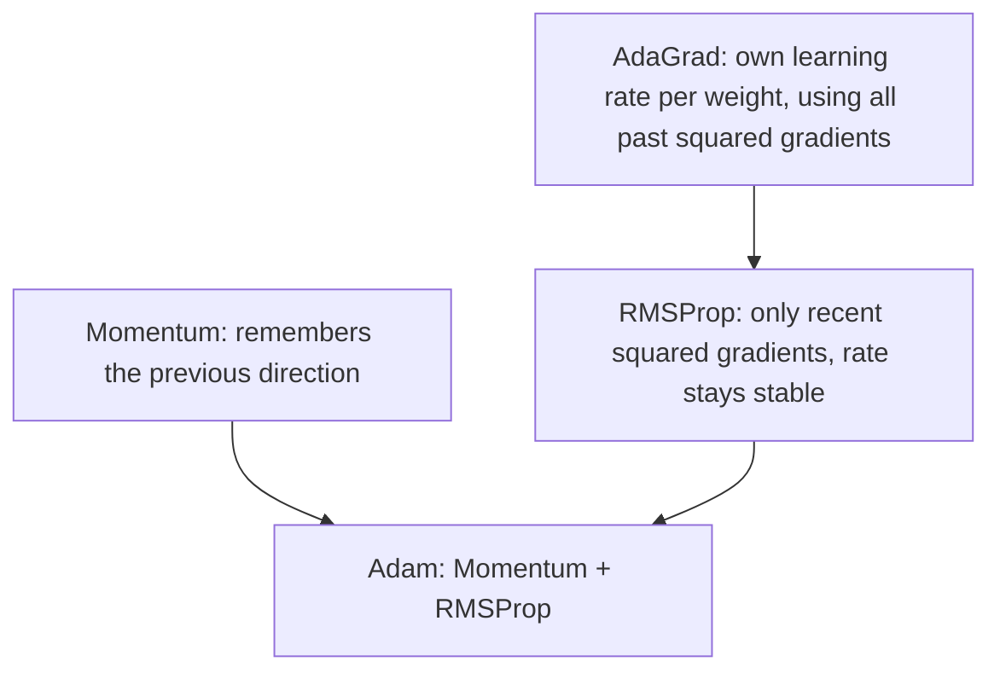

**In simple words:** AdaGrad, RMSProp and Adam are optimizers that give each weight its own learning rate; each one fixes a weakness of the one before it. <Cite id="class-dl-chp2" loc="slide 80" />

**AdaGrad (Adaptive Gradient).** The problem: one fixed learning rate is used for all weights. AdaGrad gives each weight its own rate: weights updated frequently get a smaller rate, weights updated rarely get a larger rate. $G_t = G_{t-1} + g_t^2$ and $W_{new} = W_{old} - \dfrac{\eta}{\sqrt{G_t} + \epsilon} g_t$. **Weakness:** it adds up all past squared gradients, so the learning rate keeps decreasing and may become almost zero. <Cite id="class-dl-chp2" loc="slides 80 to 82" />

**RMSProp (Root Mean Square Propagation).** It fixes AdaGrad by using only recent gradients, with a moving average: $S_t = \beta S_{t-1} + (1 - \beta) g_t^2$ and $W_{new} = W_{old} - \dfrac{\eta}{\sqrt{S_t} + \epsilon} g_t$ ($\beta$ usually 0.9). Old gradients are ignored, so the learning rate stays stable. **Weakness:** it has no momentum, and Adam usually does better. <Cite id="class-dl-chp2" loc="slides 83 to 85" />

**Adam (Adaptive Moment Estimation).** Adam combines Momentum (first moment $m_t$) and RMSProp (second moment $v_t$) with bias correction: $m_t = \beta_1 m_{t-1} + (1 - \beta_1) g_t$, $v_t = \beta_2 v_{t-1} + (1 - \beta_2) g_t^2$, $\hat m_t = m_t / (1 - \beta_1^t)$, $\hat v_t = v_t / (1 - \beta_2^t)$, $W_{new} = W_{old} - \eta\, \hat m_t / (\sqrt{\hat v_t} + \epsilon)$ ($\beta_1 = 0.9$, $\beta_2 = 0.999$). <Cite id="class-dl-chp2" loc="slides 86 to 88" />

| | AdaGrad | RMSProp | Adam |
|---|---|---|---|
| Gradient history | All past squared gradients | Recent squared gradients only | Both moments |
| Learning rate | Keeps decreasing | Stays stable | Adaptive + momentum |
| Best for | Sparse data | Deep learning, RNNs | Most deep learning (default choice) |

**Conclusion:** Adam = Momentum + RMSProp; it is fast, stable and the most widely used optimizer. <Cite id="class-dl-m2" loc="p. 65" />
