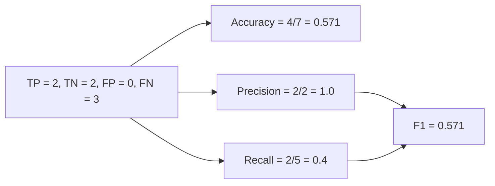

**In simple words:** accuracy sahi predictions ka share hai; F1 precision aur recall ko milata hai. Yahan accuracy lagbhag 57% hai aur F1 bhi lagbhag 0.57, lekin model zyadatar positive cases chhod deta hai. <Cite id="class-dl-m2" loc="p. 15" /> <Cite id="class-dl-qb1" loc="p. 1" />

**Formulas** <Cite id="class-dl-m2" loc="p. 15" /> <Cite id="class-dl-m2" loc="p. 16" />

Accuracy $= \dfrac{TP + TN}{TP + FP + TN + FN}$. Class notes accuracy, precision, recall aur F1 dete hain; question bank data deta hai lekin worked solution nahi, isliye upar ki standard definitions use hui hain.

<Sum>

<Given>

Y_True = 1 0 0 1 1 1 1 aur Y_Pred = 0 0 0 1 1 0 0. Class 1 positive class hai.

</Given>

<Find>

accuracy aur F1 score, interpretation ke saath.

</Find>

<Steps>

1. **Har pair compare karo (true, predicted):** (1,0) FN, (0,0) TN, (0,0) TN, (1,1) TP, (1,1) TP, (1,0) FN, (1,0) FN.
2. **Count:** TP = 2, TN = 2, FP = 0, FN = 3 (total 7).
3. **Accuracy** $= (2 + 2)/7 = 4/7 = 0.571$.
4. **Precision** $= 2/(2 + 0) = 1.0$. **Recall** $= 2/(2 + 3) = 0.4$.
5. **F1** $= 2 \times 1.0 \times 0.4/(1.0 + 0.4) = 0.8/1.4 = 0.571$.

</Steps>

<Answer>

Accuracy $= 4/7 \approx 57.1\%$ aur F1 $= 4/7 \approx 0.571$.

</Answer>

<Box kind="verify">

Counts jud kar total hote hain: $2 + 2 + 0 + 3 = 7$. F1 ko $2TP/(2TP + FP + FN) = 4/(4 + 0 + 3) = 4/7$ bhi likh sakte hain. Same result.

</Box>

</Sum>

**Interpretation:** precision 1.0 hai, matlab jab bhi model "positive" kehta hai wo sahi hota hai (koi false positive nahi). Lekin recall sirf 0.4 hai, matlab wo 5 asli positives mein se sirf 2 dhoondhta hai aur 3 chhod deta hai. 57% accuracy moderate dikhti hai, aur F1 0.57 bhi wahi balance dikhata hai: model cautious hai aur kai positives miss karta hai. F1 0 matlab worst aur 1 matlab best, isliye 0.57 ek average model hai. <Cite id="class-dl-m2" loc="p. 16" />

**Effectiveness par comment:** model sirf moderately effective hai. Jab ye positive predict kare to bharosa kar sakte hain, lekin positives detect karne mein kamzor hai, isliye jahan positive miss karna costly ho wahan use karne se pehle sudhaar (jaise zyada training ya classes ka behtar balance) chahiye.
