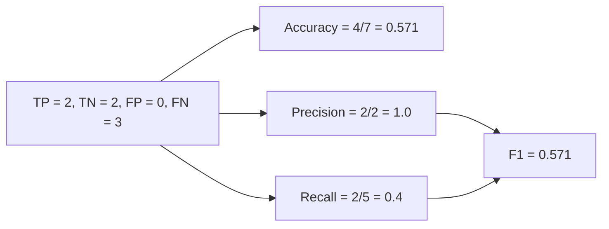

**In simple words:** accuracy is the share of correct predictions; F1 combines precision and recall. Here accuracy is about 57% and F1 is also about 0.57, but the model misses most of the positive cases. <Cite id="class-dl-m2" loc="p. 15" /> <Cite id="class-dl-qb1" loc="p. 1" />

**Formulas** <Cite id="class-dl-m2" loc="p. 15" /> <Cite id="class-dl-m2" loc="p. 16" />

Accuracy $= \dfrac{TP + TN}{TP + FP + TN + FN}$. The class notes give accuracy, precision, recall and F1; the question bank gives the data but no worked solution, and the standard definitions above are used.

<Sum>

<Given>

Y_True = 1 0 0 1 1 1 1 and Y_Pred = 0 0 0 1 1 0 0. Class 1 is the positive class.

</Given>

<Find>

accuracy and F1 score, with an interpretation.

</Find>

<Steps>

1. **Compare each pair (true, predicted):** (1,0) FN, (0,0) TN, (0,0) TN, (1,1) TP, (1,1) TP, (1,0) FN, (1,0) FN.
2. **Count:** TP = 2, TN = 2, FP = 0, FN = 3 (total 7).
3. **Accuracy** $= (2 + 2)/7 = 4/7 = 0.571$.
4. **Precision** $= 2/(2 + 0) = 1.0$. **Recall** $= 2/(2 + 3) = 0.4$.
5. **F1** $= 2 \times 1.0 \times 0.4/(1.0 + 0.4) = 0.8/1.4 = 0.571$.

</Steps>

<Answer>

Accuracy $= 4/7 \approx 57.1\%$ and F1 $= 4/7 \approx 0.571$.

</Answer>

<Box kind="verify">

The counts add up: $2 + 2 + 0 + 3 = 7$. F1 can also be written $2TP/(2TP + FP + FN) = 4/(4 + 0 + 3) = 4/7$. Same result.

</Box>

</Sum>

**Interpretation:** precision is 1.0, so every time the model says "positive" it is right (no false positives). But recall is only 0.4, so it finds just 2 of the 5 real positives and misses 3. Accuracy of 57% looks moderate, and F1 of 0.57 shows the same balance: the model is cautious and misses many positives. F1 of 0 means worst and 1 means best, so 0.57 is an average model. <Cite id="class-dl-m2" loc="p. 16" />

**Comment on effectiveness:** the model is only moderately effective. It is trustworthy when it predicts positive, but it is weak at detecting positives, so it needs improvement (for example more training or a better balance of the classes) before use where missing a positive is costly.
