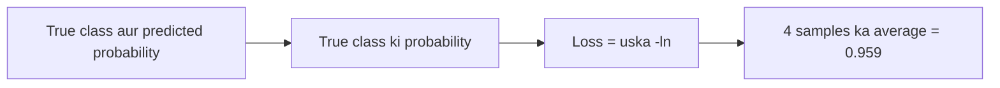

**In simple words:** cross-entropy loss dekhta hai ki model ne true class ko kitni probability di. Sahi class ko high probability se small loss, aur low probability se large loss milta hai. <Cite id="class-dl-chp2" loc="slide 40" />

**Formula (binary cross entropy):** $\text{BCE} = -\big(y\log\hat y + (1 - y)\log(1 - \hat y)\big)$, samples par averaged: $y = 1$ ho to loss $-\ln\hat y$, $y = 0$ ho to $-\ln(1 - \hat y)$. Natural log use hota hai. Data assignment question bank se hai. <Cite id="class-dl-qb1" loc="p. 1" /> <Cite id="class-dl-chp2" loc="slide 40" /> <Cite id="class-dl-m2" loc="p. 14" />

<Sum>

<Given>

Y_True = 1, 1, 0, 0 aur predicted probability (class 1 ki) = 0.8, 0.1, 0.1, 0.7.

</Given>

<Find>

cross-entropy loss aur uski interpretation.

</Find>

<Steps>

1. **Sample 1** ($y = 1$, $\hat y = 0.8$): $-\ln(0.8) = 0.2231$.
2. **Sample 2** ($y = 1$, $\hat y = 0.1$): $-\ln(0.1) = 2.3026$.
3. **Sample 3** ($y = 0$, $\hat y = 0.1$): $-\ln(1 - 0.1) = -\ln(0.9) = 0.1054$.
4. **Sample 4** ($y = 0$, $\hat y = 0.7$): $-\ln(1 - 0.7) = -\ln(0.3) = 1.2040$.
5. **Add:** $0.2231 + 2.3026 + 0.1054 + 1.2040 = 3.8351$.
6. **$n = 4$ se average:** $3.8351/4 = 0.9588$.

</Steps>

<Answer>

Cross-entropy loss $\approx 0.959$.

</Answer>

<Box kind="verify">

Har log ko wapas check karo: $e^{-0.2231} = 0.800$, $e^{-2.3026} = 0.100$, $e^{-0.1054} = 0.900$, $e^{-1.2040} = 0.300$. Chaaron true class ko di gayi probability se match karte hain.

</Box>

</Sum>

| Sample | True | Class 1 ki probability | True class ko di gayi probability | Loss |
|---|---|---|---|---|
| 1 | 1 | 0.8 | 0.8 | 0.223 |
| 2 | 1 | 0.1 | 0.1 | 2.303 |
| 3 | 0 | 0.1 | 0.9 | 0.105 |
| 4 | 0 | 0.7 | 0.3 | 1.204 |

**Interpretation:** samples 1 aur 3 achhe predict hue (small losses 0.223 aur 0.105). Sample 2 galat aur confident hai (true 1 ke liye probability 0.1), isliye uska loss 2.303 bahut bada hai; sample 4 bhi galat hai (true 0 ke liye 0.7) aur loss 1.204. Ye do kharab samples average ko 0.959 tak badha dete hain. Achhe model ka average loss 0 ke paas hona chahiye, isliye model ki performance moderate se poor hai: aadhi predictions galat hain, aur confident galtiyon ko heavily punish kiya jaata hai. <Cite id="class-dl-chp2" loc="slide 39" />

**Conclusion:** lagbhag 0.96 ka loss dikhata hai ki model abhi reliable nahi hai; ise kam karne ke liye training jaari rakhni chahiye.
