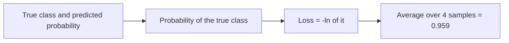

**In simple words:** cross-entropy loss looks at the probability the model gave to the true class. A high probability for the right class gives a small loss, and a low one gives a large loss. <Cite id="class-dl-chp2" loc="slide 40" />

**Formula (binary cross entropy):** $\text{BCE} = -\big(y\log\hat y + (1 - y)\log(1 - \hat y)\big)$, averaged over the samples: if $y = 1$ the loss is $-\ln\hat y$, if $y = 0$ it is $-\ln(1 - \hat y)$. Natural log is used. The data is from the assignment question bank. <Cite id="class-dl-qb1" loc="p. 1" /> <Cite id="class-dl-chp2" loc="slide 40" /> <Cite id="class-dl-m2" loc="p. 14" />

<Sum>

<Given>

Y_True = 1, 1, 0, 0 and predicted probability (of class 1) = 0.8, 0.1, 0.1, 0.7.

</Given>

<Find>

the cross-entropy loss and its interpretation.

</Find>

<Steps>

1. **Sample 1** ($y = 1$, $\hat y = 0.8$): $-\ln(0.8) = 0.2231$.
2. **Sample 2** ($y = 1$, $\hat y = 0.1$): $-\ln(0.1) = 2.3026$.
3. **Sample 3** ($y = 0$, $\hat y = 0.1$): $-\ln(1 - 0.1) = -\ln(0.9) = 0.1054$.
4. **Sample 4** ($y = 0$, $\hat y = 0.7$): $-\ln(1 - 0.7) = -\ln(0.3) = 1.2040$.
5. **Add:** $0.2231 + 2.3026 + 0.1054 + 1.2040 = 3.8351$.
6. **Average over $n = 4$:** $3.8351/4 = 0.9588$.

</Steps>

<Answer>

Cross-entropy loss $\approx 0.959$.

</Answer>

<Box kind="verify">

Check each log by going back: $e^{-0.2231} = 0.800$, $e^{-2.3026} = 0.100$, $e^{-0.1054} = 0.900$, $e^{-1.2040} = 0.300$. All four match the probability given to the true class.

</Box>

</Sum>

| Sample | True | Probability of class 1 | Probability given to the true class | Loss |
|---|---|---|---|---|
| 1 | 1 | 0.8 | 0.8 | 0.223 |
| 2 | 1 | 0.1 | 0.1 | 2.303 |
| 3 | 0 | 0.1 | 0.9 | 0.105 |
| 4 | 0 | 0.7 | 0.3 | 1.204 |

**Interpretation:** samples 1 and 3 are predicted well (small losses 0.223 and 0.105). Sample 2 is wrong and confident (probability 0.1 for a true 1), so its loss 2.303 is very large; sample 4 is also wrong (0.7 for a true 0) with loss 1.204. These two bad samples raise the average to 0.959. A good model would have an average loss close to 0, so the model's performance is only moderate to poor: half of the predictions are wrong, and the confident mistakes are punished heavily. <Cite id="class-dl-chp2" loc="slide 39" />

**Conclusion:** the loss of about 0.96 shows the model is not yet reliable; training should continue to lower it.
