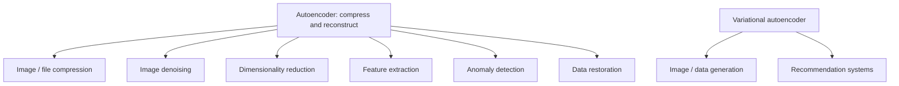

**In simple words:** autoencoder ek chhota code seekhta hai jo data ka important hissa rakhta hai, to wahi idea wahan use hota hai jahan data chhota karna, saaf karna, unusual dhundna, ya (VAE ke saath) naya data banana ho. <Cite id="class-dl-chp3" loc="slides 34 and 35" />

**Autoencoders ke applications.**

1. **Image / file compression:** encoder chhoti representation banata hai, decoder image rebuild karta hai (bade image ko storage ya fast transmission ke liye compress).
2. **Image denoising:** denoising autoencoder noisy photo ko clean photo banata hai; ye watermarks bhi hataata hai.
3. **Dimensionality reduction:** 1000 features se 100 important features, classification ya clustering ke liye.
4. **Feature extraction:** encoder important features (face ke edges, shapes) seekhta hai kisi dusre model ke liye.
5. **Anomaly detection:** normal data par train karo; **high reconstruction error matlab anomaly ya defect** (fraud detection, industrial defects).
6. **Data restoration:** damaged ya missing data reconstruct karna (damaged image restore); image inpainting aur black-and-white picture ko colour karna bhi.
7. **Recommendation systems:** user ki preferences seekhkar doosri movie recommend karna. <Cite id="class-dl-chp3" loc="slides 34 and 35" /> <Cite id="class-dl-m3" loc="pp. 25-27" />

**Variational autoencoder (VAE) ke applications.** VAE latent space mein probability distribution (μ aur σ²) seekhta hai, ek point z sample karta hai aur decode karta hai, to wo **training data jaisa naya data generate** kar sakta hai: image generation (naye fruit-like images), synthetic data creation, image reconstruction, anomaly detection, drug ya molecule generation, data compression, signal processing aur recommendation. <Cite id="class-dl-chp3" loc="slides 27 and 34" /> <Cite id="class-dl-m3" loc="p. 29" />

| | Autoencoder | VAE |
|---|---|---|
| Latent code | Fixed point | Distribution (μ, σ²) |
| Best for | Compression, denoising, anomaly detection, features | Naya data generate karna |

**Note:** image-to-image translation zyada commonly GANs se judi hai, isliye ise general autoencoder application ki tarah list nahi karte. <Cite id="class-dl-chp3" loc="slide 34" />

**Conclusion:** autoencoders compress, clean aur detect karte hain; VAE generation add karta hai.

Exam mein English mein likho: "Autoencoders are used for compression, denoising, dimensionality reduction, feature extraction and anomaly detection; VAEs also generate new data."
