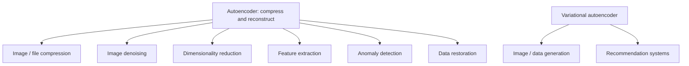

**In simple words:** an autoencoder learns a short code that keeps the important part of the data, so the same idea is used wherever we want to shrink data, clean data, find the unusual, or (with a VAE) make new data. <Cite id="class-dl-chp3" loc="slides 34 and 35" />

**Applications of autoencoders.**

1. **Image / file compression:** the encoder makes a small representation, the decoder rebuilds the image (compress a large image for storage or fast transmission).
2. **Image denoising:** a denoising autoencoder turns a noisy photo into a clean one; it also removes watermarks.
3. **Dimensionality reduction:** 1000 features become 100 important features, used for classification or clustering.
4. **Feature extraction:** the encoder learns important features (edges, shapes of a face) for another model.
5. **Anomaly detection:** train on normal data; **high reconstruction error means an anomaly or defect** (fraud detection, industrial defects).
6. **Data restoration:** reconstruct damaged or missing data (restore a damaged image); also image inpainting and colouring a black-and-white picture.
7. **Recommendation systems:** learn the user's preferences and recommend another movie. <Cite id="class-dl-chp3" loc="slides 34 and 35" /> <Cite id="class-dl-m3" loc="pp. 25-27" />

**Applications of the variational autoencoder (VAE).** A VAE learns a probability distribution in the latent space (μ and σ²), samples a point z and decodes it, so it can generate **new data similar to the training data**: image generation (new fruit-like images), synthetic data creation, image reconstruction, anomaly detection, drug or molecule generation, data compression, signal processing and recommendation. <Cite id="class-dl-chp3" loc="slides 27 and 34" /> <Cite id="class-dl-m3" loc="p. 29" />

| | Autoencoder | VAE |
|---|---|---|
| Latent code | Fixed point | Distribution (μ, σ²) |
| Best for | Compression, denoising, anomaly detection, features | Generating new data |

**Note:** image-to-image translation is more commonly associated with GANs, so it is not listed as a general autoencoder application. <Cite id="class-dl-chp3" loc="slide 34" />

**Conclusion:** autoencoders compress, clean and detect; the VAE adds generation.
