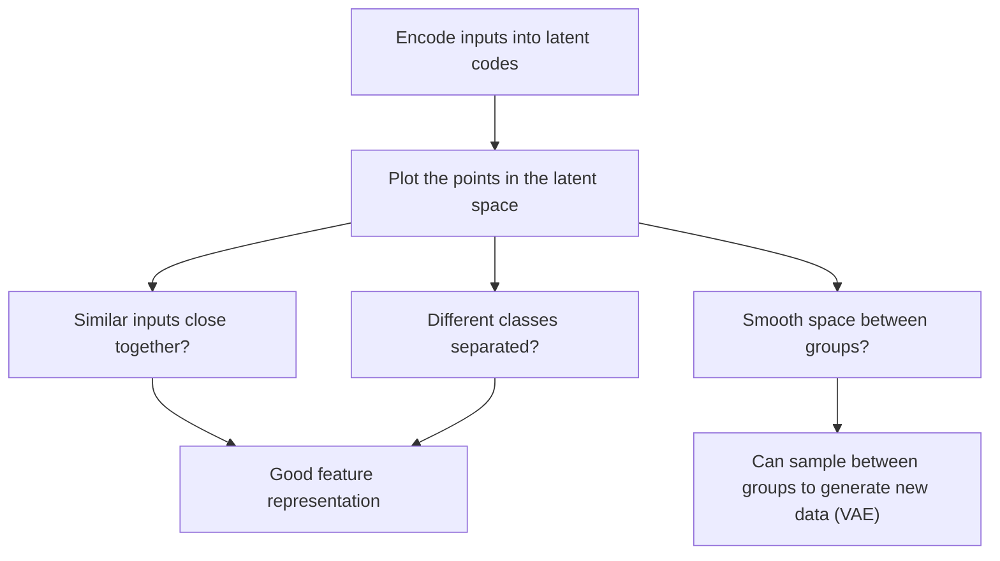

**In simple words:** latent space wo jagah hai jahan autoencoder har input ka chhota code rakhta hai. Use dekhna (visualize karna) batata hai autoencoder ne kya seekha: kaun se inputs ko wo similar maanta hai, aur code ke har number ka kya matlab hai. <Cite id="class-dl-chp3" loc="slide 4" />

**Latent space mein kya hota hai.** Encoder har input ko chhote numbers ke set mein compress karta hai (latent code, jaise [0.8, 0.3, 0.6, 0.2, …]); latent space mein in numbers se bana point us input ki learned representation hai. <Cite id="class-dl-chp3" loc="slide 4" />

**Role 1: har value ka matlab samajhna.** Faces ke liye textbook latent attributes dikhata hai jaise Smile 0.99, Skin tone 0.85, Gender −0.73, Beard 0.85, Glasses 0.002 aur Hair colour 0.68: autoencoder observation ko descriptive attributes se describe karta hai. <Cite id="class-dl-m3" loc="p. 30" />

**Role 2: similar inputs ko saath dekhna.** Teacher ke two-dimensional plot mein laal apples ek group aur hare apples doosra group banate hain: **similar inputs ek dusre ke paas hote hain**. Agar groups alag hain to representation ne asli difference pakad liya hai. <Cite id="class-dl-chp3" loc="slide 28" />

**Role 3: smoothness aur generation.** VAE har attribute ko probability distribution ki tarah encode karta hai aur usse sample karta hai. Ye "a continuous, smooth latent space" enforce karta hai, to latent space mein paas ki values bahut similar reconstructions deti hain, aur hum learned examples ke beech sample karke naya par similar data generate kar sakte hain. <Cite id="class-dl-m3" loc="pp. 31-33" />

**Latent space visualization ka aim:** check karna ki autoencoder ne kya seekha, kya similar inputs saath baithte hain aur kya space itna smooth hai ki naye samples generate ho sakein. <Cite id="class-dl-m3" loc="p. 35" />

**Limit:** class files sirf picture, face attributes aur aim deti hain; plot kaise banta hai ye nahi dikhatin.

**Conclusion:** latent space visualize karne se pata chalta hai ki learned features meaningful hain ya nahi.

Exam mein English mein likho: "Latent space visualization shows whether similar inputs are close together and whether the learned representation is meaningful."
