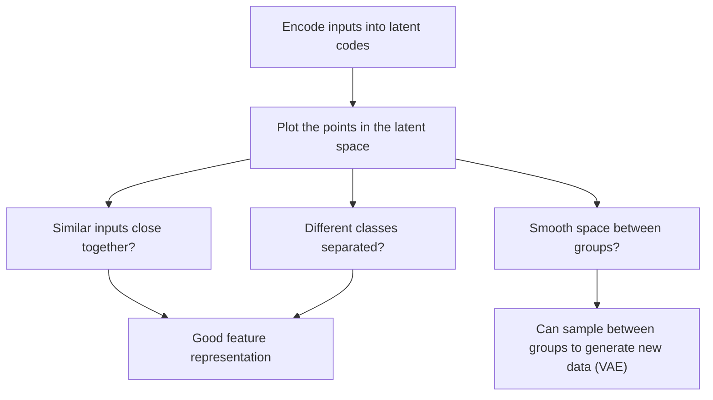

**In simple words:** the latent space is where the autoencoder keeps its short code for every input. Looking at it (visualizing it) shows what the autoencoder has learned: which inputs it treats as similar, and what each number in the code means. <Cite id="class-dl-chp3" loc="slide 4" />

**What the latent space holds.** The encoder compresses each input into a small set of numbers (the latent code, for example [0.8, 0.3, 0.6, 0.2, …]); the point formed by these numbers in the latent space is the learned representation of that input. <Cite id="class-dl-chp3" loc="slide 4" />

**Role 1: understanding what each value means.** For faces the textbook shows latent attributes such as Smile 0.99, Skin tone 0.85, Gender −0.73, Beard 0.85, Glasses 0.002 and Hair colour 0.68: the autoencoder describes an observation by descriptive attributes. <Cite id="class-dl-m3" loc="p. 30" />

**Role 2: seeing similar inputs together.** In the teacher's two-dimensional plot red apples form one group and green apples another: **similar inputs are located near each other**. If the groups are separate, the representation has captured the real difference. <Cite id="class-dl-chp3" loc="slide 28" />

**Role 3: smoothness and generation.** A VAE encodes each attribute as a probability distribution and samples from it. This enforces "a continuous, smooth latent space", so values that are close in latent space give very similar reconstructions, and we can sample between the learned examples to generate new but similar data. <Cite id="class-dl-m3" loc="pp. 31-33" />

**Aim of latent space visualization:** to check what the autoencoder has learned, whether similar inputs sit together and whether the space is smooth enough to generate new samples. <Cite id="class-dl-m3" loc="p. 35" />

**Limit:** the class files give the picture, the face attributes and the aim only; they do not show how the plot is drawn.

**Conclusion:** visualizing the latent space shows whether the learned features are meaningful.
