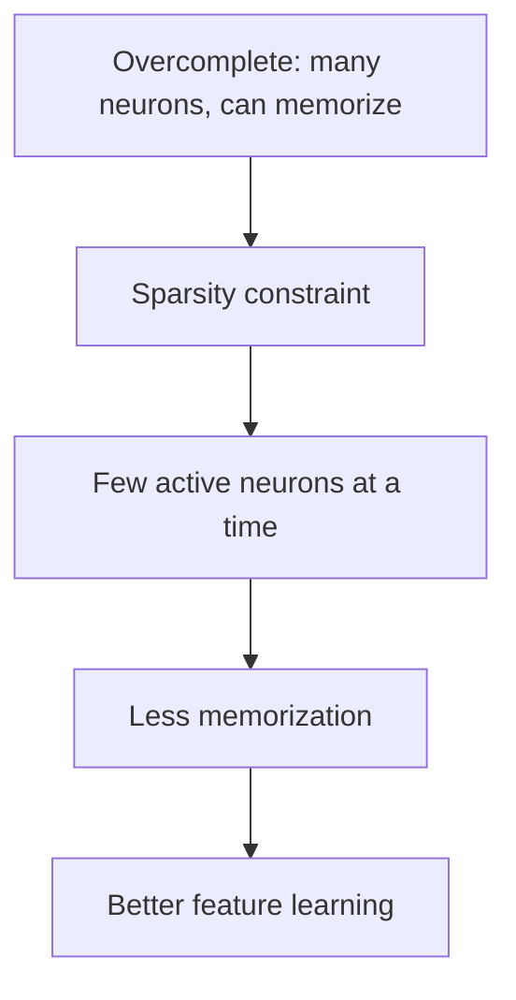

**In simple words:** sparse autoencoder har input ke liye sirf kuch hidden neurons ko on hone deta hai, to wo memorize nahi kar sakta; use wo kuch neurons chunne padte hain jo sach mein matter karte hain. Ye overfitting ke khilaaf madad karta hai, par perfect ilaaj nahi hai. <Cite id="class-dl-chp3" loc="slide 19" />

**Overfitting ki problem.** Overcomplete autoencoder mein hidden layer mein bahut neurons hote hain, to network useful features seekhne ke bajaye input simply memorize ya copy kar sakta hai. <Cite id="class-dl-chp3" loc="slide 19" />

**Sparse autoencoder kaise kaam karta hai.** Ye ek samay mein sirf kuch hidden neurons ko active hone deta hai (jaise 100 mein se 5 se 10) aur zyadatar inactive rehte hain. Loss mein sparsity penalty add hoti hai: **Total Loss = Reconstruction Loss + Sparsity Penalty**. Penalty activations par L1 ya KL divergence hai, jo har hidden unit ki average activation limit karti hai. Kaun se neurons on honge ye input par depend karta hai. <Cite id="class-dl-chp3" loc="slide 20" /> <Cite id="class-dl-m3" loc="pp. 17 and 19" />

**Evaluation (effectiveness).**

- **Strengths:** memorization rokta hai, overfitting kam karta hai, meaningful aur interpretable features seekhta hai, aur overcomplete hidden layer ko input simply copy kiye bina allow karta hai. Textbook add karta hai ki ye memorize karne ki capacity ko limit karta hai **feature extract karne ki capability ko limit kiye bina**, to code size aur regularization alag-alag chune ja sakte hain. <Cite id="class-dl-chp3" loc="slides 19 and 20" /> <Cite id="class-dl-m3" loc="p. 19" />
- **Limits:** extra sparsity penalty chahiye, sparsity level dhyan se chunna padta hai, training zyada complex hai, aur **bahut zyada sparsity important information kho sakti hai**. <Cite id="class-dl-chp3" loc="slide 20" />

| | Overcomplete | Sparse |
|---|---|---|
| Active neurons | Bahut | Sirf kuch |
| Memorization | High chance | Low chance |
| Regularization chahiye | Yes | Built-in (sparsity penalty) |

**Conclusion:** sparsity level achhe se chuna jaaye to sparse autoencoders overfitting ke khilaaf effective hain; bahut zyada sparsity information kho deti hai.

Exam mein English mein likho: "A sparse autoencoder keeps only a few neurons active, which prevents memorization and reduces overfitting."
