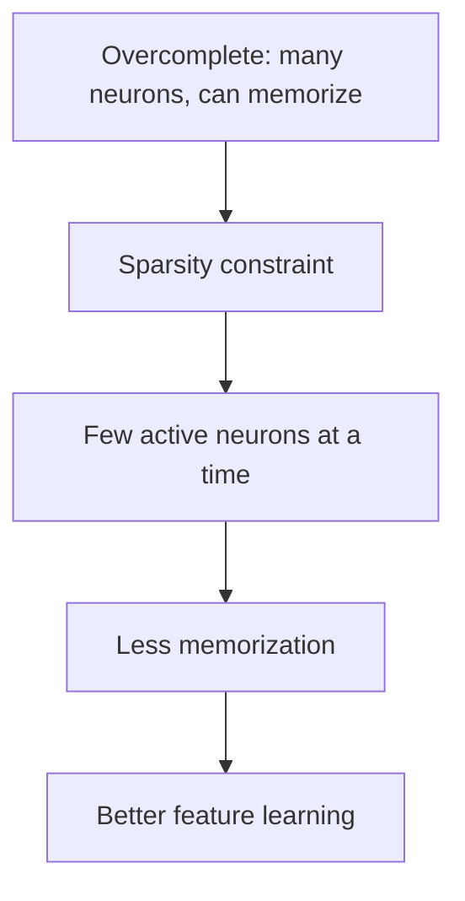

**In simple words:** a sparse autoencoder lets only a few hidden neurons switch on for each input, so it cannot memorize; it has to pick the few neurons that really matter. This helps against overfitting, but it is not a perfect cure. <Cite id="class-dl-chp3" loc="slide 19" />

**The overfitting problem.** In an overcomplete autoencoder the hidden layer has many neurons, so the network can simply memorize or copy the input instead of learning useful features. <Cite id="class-dl-chp3" loc="slide 19" />

**How a sparse autoencoder works.** It forces only a small number of hidden neurons to be active at a time (for example 5 to 10 of 100) and most stay inactive. A sparsity penalty is added to the loss: **Total Loss = Reconstruction Loss + Sparsity Penalty**. The penalty is L1 on the activations or KL divergence, which limits the average activation of each hidden unit. Which neurons switch on depends on the input. <Cite id="class-dl-chp3" loc="slide 20" /> <Cite id="class-dl-m3" loc="pp. 17 and 19" />

**Evaluation (effectiveness).**

- **Strengths:** it prevents memorization, reduces overfitting, learns meaningful and interpretable features, and allows an overcomplete hidden layer without simply copying the input. The textbook adds that it limits the capacity to memorize **without limiting the capability to extract features**, so the code size and the regularization can be chosen separately. <Cite id="class-dl-chp3" loc="slides 19 and 20" /> <Cite id="class-dl-m3" loc="p. 19" />
- **Limits:** it needs an extra sparsity penalty, the sparsity level must be chosen carefully, training is more complex, and **too much sparsity may lose important information**. <Cite id="class-dl-chp3" loc="slide 20" />

| | Overcomplete | Sparse |
|---|---|---|
| Active neurons | Many | Only a few |
| Memorization | High chance | Low chance |
| Needs regularization | Yes | Built-in (sparsity penalty) |

**Conclusion:** sparse autoencoders are effective against overfitting when the sparsity level is chosen well; too much sparsity loses information.
