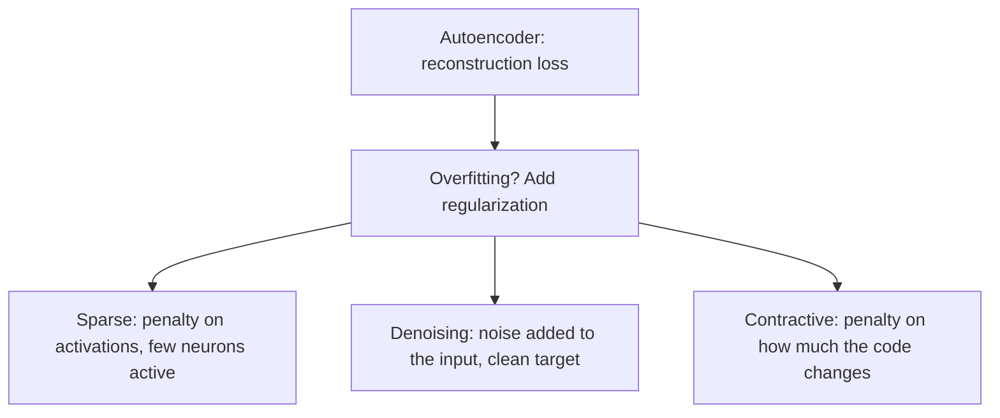

**In simple words:** sparse, denoising aur contractive autoencoders network ko apna input simply copy karne se rokne ke teen tareeke hain: zyadatar neurons off karo, input ko damage karo, ya code ko steady rakho. <Cite id="class-dl-chp3" loc="slide 31" />

**Sparse.** Ek samay mein sirf kuch hidden neurons active. Loss = Reconstruction Loss + Sparsity Penalty (activations par L1 ya KL divergence). Ye memorization rokta hai aur overcomplete layers ke liye suitable hai. <Cite id="class-dl-chp3" loc="slides 19 and 20" />

**Denoising.** Input jaan-boojh kar noisy hai, target original clean input hai (Noisy Input → Autoencoder → Clean Output). Model wo important features seekhta hai jo kuch information damage hone par bhi bache rahein. Ye noise hataata hai aur robust features seekhta hai. <Cite id="class-dl-chp3" loc="slides 23 and 24" />

**Contractive.** Input ka chhota change code mein sirf chhota change dena chahiye. Loss = Reconstruction Loss + Contractive Penalty, jahan penalty $\lambda \left\lVert \dfrac{\partial h}{\partial x} \right\rVert_F^2$ code ke slope par hai. Ye stable features deta hai. <Cite id="class-dl-chp3" loc="slides 21 and 22" />

| | Sparse | Denoising | Contractive |
|---|---|---|---|
| Idea | Kam neurons active | Noisy input, clean target | Input mein chhota change, code mein chhota change |
| Kya add hota hai | Sparsity penalty | Input par noise | Contractive penalty |
| Focus | Kaun se neurons activate? | Noise hataana | Code kitna badalta hai? |
| Main benefit | Memorization nahi; overcomplete ke saath kaam | Robust features, clean output | Stable, robust features |
| Drawback | Bahut zyada sparsity information kho deti hai | Suitable noise chahiye; details hata sakta hai | Extra penalty, $\lambda$ chunna |

**Same aur different.** Teeno reconstruction loss ke upar regularization add karte hain aur simple copying se bachte hain. Sparse activations par, denoising data par, contractive encoder ki sensitivity par kaam karta hai. Textbook: denoising decoder ko input ke chhote par finite perturbations ke prati resist karwata hai, contractive encoder ko infinitesimal perturbations ke prati. <Cite id="class-dl-m3" loc="p. 22" />

**Conclusion:** memorization se bachne ke liye sparse, data saaf karne ke liye denoising, stable features ke liye contractive chuno.

Exam mein English mein likho: "Sparse keeps few neurons active, denoising reconstructs clean data from noisy input, and contractive keeps the code stable for small input changes."
