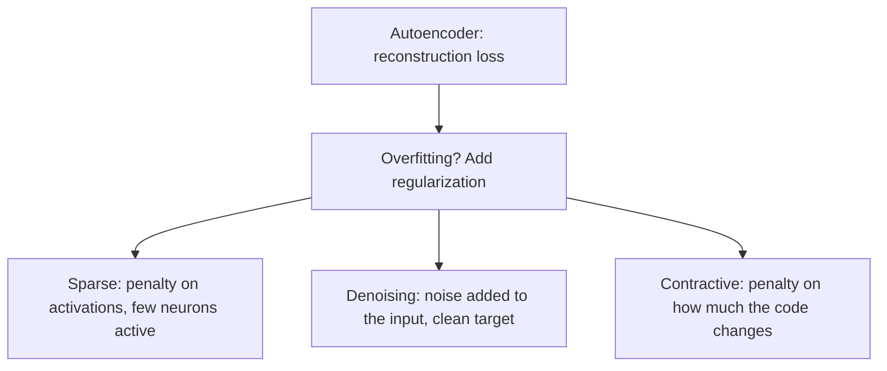

**In simple words:** sparse, denoising and contractive autoencoders are three ways to stop a network from simply copying its input: switch most neurons off, damage the input, or keep the code steady. <Cite id="class-dl-chp3" loc="slide 31" />

**Sparse.** Only a few hidden neurons are active at a time. Loss = Reconstruction Loss + Sparsity Penalty (L1 or KL divergence on the activations). It prevents memorization and suits overcomplete layers. <Cite id="class-dl-chp3" loc="slides 19 and 20" />

**Denoising.** The input is intentionally noisy, the target is the original clean input (Noisy Input → Autoencoder → Clean Output). The model learns important features that remain even when some information is damaged. It removes noise and learns robust features. <Cite id="class-dl-chp3" loc="slides 23 and 24" />

**Contractive.** A small input change should give only a small change in the code. Loss = Reconstruction Loss + Contractive Penalty, with penalty $\lambda \left\lVert \dfrac{\partial h}{\partial x} \right\rVert_F^2$ on the slope of the code. It gives stable features. <Cite id="class-dl-chp3" loc="slides 21 and 22" />

| | Sparse | Denoising | Contractive |
|---|---|---|---|
| Idea | Few neurons active | Noisy input, clean target | Small input change, small code change |
| What is added | Sparsity penalty | Noise on the input | Contractive penalty |
| Focus | Which neurons activate? | Remove noise | How much does the code change? |
| Main benefit | No memorization; works with overcomplete | Robust features, clean output | Stable, robust features |
| Drawback | Too much sparsity loses information | Needs suitable noise; may remove details | Extra penalty, choosing $\lambda$ |

**Same and different.** All three add regularization on top of the reconstruction loss and avoid simple copying. Sparse acts on the activations, denoising on the data, contractive on the encoder's sensitivity. The textbook: denoising makes the decoder resist small but finite perturbations of the input, contractive makes the encoder resist infinitesimal perturbations. <Cite id="class-dl-m3" loc="p. 22" />

**Conclusion:** choose sparse to avoid memorization, denoising to clean data, contractive for stable features.
