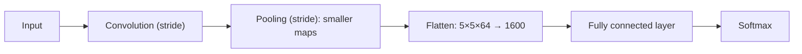

**In simple words:** stride tay karta hai ki filter kitni door kood-kar jaaye, isliye wo output chhota karta hai. Pooling chhote regions ko ek number se badalta hai, isliye feature maps chhote hote hain. Flatten maps ko fully connected layer ke liye ek list mein badalta hai; ye tab hi chahiye jab aisi layer aage ho. <Cite id="class-dl-qb2" loc="Q4" />

**Stride ka use.** **Stride** wo pixels ki sankhya hai jitne se filter har step par image par move karta hai. Stride 1 zyada positions check karta hai aur output bada deta hai; stride 2 kam positions check karta hai aur output chhota deta hai. Isliye bada stride feature map ka spatial size aur computation kam karta hai. Stride "kitni door" hai; padding image ke around pixels jodta hai. <Cite id="class-dl-chp4" loc="slide 12" /> <Cite id="class-dl-chp4" loc="slide 19" />

**Pooling ka use.** Pooling layer feature maps ka size kam karti hai aur most important information rakhti hai. Ye height aur width (depth nahi), computation aur agli layers ke parameters kam karti hai, model ko chhote shifts ke prati kam sensitive banati hai, aur max pooling noise bhi suppress karta hai. 2×2 window stride 2 ke saath 8×8 ko 4×4 bana deti hai. <Cite id="class-dl-chp4" loc="slide 31" /> <Cite id="class-dl-m4" loc="p. 35" />

**Kya flattening zaroori hai?** Flattening 3D feature maps ko 1D column vector mein badalti hai, jo fully connected (feed-forward) layers ko di jaati hai. Usual CNN classifier (convolution, pooling, phir fully connected layers aur softmax) ke liye ye **zaroori** hai, kyunki fully connected layer vector leti hai: 5×5×64 ban jaata hai 1600 values. Jab aage koi fully connected layer na ho to **zaroori nahi**: GoogLeNet fully connected layers ki jagah global average pooling use karta hai, aur U-Net ek fully convolutional network hai. <Cite id="class-dl-chp4" loc="slide 28" /> <Cite id="class-dl-m4" loc="p. 38" /> <Cite id="class-dl-m4" loc="p. 64" /> <Cite id="class-dl-m4" loc="p. 80" />

<Sum>

<Given>

(a) 7×7 input, 3×3 filter, padding nahi, stride 1 aur 2. (b) 8×8 map, 2×2 pooling window, stride 2. (c) 5×5×64 ke feature maps.

</Given>

<Find>

output sizes aur flattened vector ki length.

</Find>

<Steps>

1. **Stride 1:** $(7 - 3)/1 + 1 = 5$, to 5×5.
2. **Stride 2:** $(7 - 3)/2 + 1 = 3$, to 3×3. Bada stride chhota output deta hai.
3. **Pooling:** $(8 - 2)/2 + 1 = 4$, to 4×4; depth wahi rehti hai.
4. **Flatten:** $5 \times 5 \times 64 = 1600$ values.

</Steps>

<Answer>

5×5 (stride 1), 3×3 (stride 2), pooling 8×8 → 4×4, flatten 1600 values deta hai.

</Answer>

<Box kind="verify">

Stride 2 ke liye positions check: filter columns 1, 3 aur 5 se shuru hota hai (column 7 se shuru fit nahi hoga), isliye har side 3 positions. Flatten har number rakhta hai: $25 \times 64 = 1600$.

</Box>

</Sum>

**Conclusion:** stride aur pooling data chhota karte hain; flatten fully connected layers ka pul hai aur sirf tab chahiye jab wo use hon.
