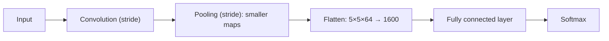

**In simple words:** stride decides how far the filter jumps, so it shrinks the output. Pooling replaces small regions by one number, so it shrinks the feature maps. Flatten turns the maps into one list for the fully connected layer; it is needed only when such a layer follows. <Cite id="class-dl-qb2" loc="Q4" />

**Use of stride.** **Stride** is the number of pixels by which the filter moves across the image at each step. Stride 1 checks more positions and gives a larger output; stride 2 checks fewer positions and gives a smaller output. So a larger stride reduces the spatial size of the feature map and the computation. Stride is "how far"; padding adds pixels around the image. <Cite id="class-dl-chp4" loc="slide 12" /> <Cite id="class-dl-chp4" loc="slide 19" />

**Use of pooling.** A pooling layer reduces the size of feature maps while keeping the most important information. It reduces height and width (not depth), computation and the parameters of later layers, makes the model less sensitive to small shifts, and max pooling also suppresses noise. A 2×2 window with stride 2 turns 8×8 into 4×4. <Cite id="class-dl-chp4" loc="slide 31" /> <Cite id="class-dl-m4" loc="p. 35" />

**Is flattening necessary?** Flattening converts the 3D feature maps into a 1D column vector, which is fed to the fully connected (feed-forward) layers. For the usual CNN classifier (convolution, pooling, then fully connected layers and softmax) it is **necessary**, because a fully connected layer takes a vector: 5×5×64 becomes 1600 values. It is **not needed** when no fully connected layer follows: GoogLeNet uses global average pooling instead of fully connected layers, and U-Net is a fully convolutional network. <Cite id="class-dl-chp4" loc="slide 28" /> <Cite id="class-dl-m4" loc="p. 38" /> <Cite id="class-dl-m4" loc="p. 64" /> <Cite id="class-dl-m4" loc="p. 80" />

<Sum>

<Given>

(a) a 7×7 input, 3×3 filter, no padding, strides 1 and 2. (b) An 8×8 map, 2×2 pooling window, stride 2. (c) Feature maps of 5×5×64.

</Given>

<Find>

the output sizes and the length of the flattened vector.

</Find>

<Steps>

1. **Stride 1:** $(7 - 3)/1 + 1 = 5$, so 5×5.
2. **Stride 2:** $(7 - 3)/2 + 1 = 3$, so 3×3. The larger stride gives the smaller output.
3. **Pooling:** $(8 - 2)/2 + 1 = 4$, so 4×4; the depth is unchanged.
4. **Flatten:** $5 \times 5 \times 64 = 1600$ values.

</Steps>

<Answer>

5×5 (stride 1), 3×3 (stride 2), pooling 8×8 → 4×4, flatten gives 1600 values.

</Answer>

<Box kind="verify">

Positions check for stride 2: the filter starts at columns 1, 3 and 5 (a start at column 7 would not fit), so 3 positions per side. Flatten keeps every number: $25 \times 64 = 1600$.

</Box>

</Sum>

**Conclusion:** stride and pooling shrink the data; flatten is the bridge to the fully connected layers and is needed only when they are used.
