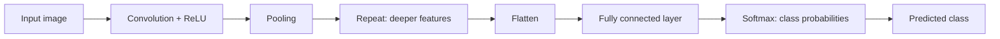

**In simple words:** CNN se image classification matlab picture ko numbers mein badalna, convolution aur pooling se features dhundna, aur phir fully connected layers aur softmax se class ka naam batana. <Cite id="class-dl-qb2" loc="Q4" />

**Image classification ke steps (jaise cats versus dogs)** <Cite id="class-dl-chp4" loc="slide 28" /> <Cite id="class-dl-m4" loc="p. 88" /> <Cite id="class-dl-m4" loc="p. 89" />

1. **Input image:** computer ko numbers ka grid dikhta hai, har pixel ke liye ek; RGB image ke 3 channels hote hain (jaise 32×32×3). <Cite id="class-dl-chp4" loc="slide 2" />
2. **Convolution + ReLU:** filters (learnable weights ke chhote matrices) image par slide karte hain aur feature maps dete hain; early filters edges dhundte hain. Output size $\lfloor (N - F + 2P)/S \rfloor + 1$.
3. **Pooling:** max pooling har feature map ko chhota karta hai, sabse strong values rakhkar. Channels ki sankhya filters ki sankhya hoti hai.
4. Convolution aur pooling **repeat** karo: deeper layers curves, shapes, object parts aur poora object dhundti hain.
5. **Flatten:** final feature maps 1D vector ban jaate hain (5×5×64 se 1600).
6. **Fully connected layer:** seekhe hue features ko combine karti hai.
7. **Softmax:** class probabilities deta hai (Cat 0.10, Dog 0.80, Horse 0.10); sabse high predicted class hai, Dog.
8. **Training:** prediction → loss → backpropagation → filter weights update hote hain; filters haath se koi set nahi karta. <Cite id="class-dl-chp4" loc="slide 8" />

**Object detection.** Class files object detection ko image classification ke saath CNNs ki ek application batati hain, lekin iske liye steps ki alag list nahi deti. Features dhundne wale steps 1 se 4 same hain; fark ye hai ki network ko poori image ke liye ek label dene ki jagah batana hai ki kaunsa object hai (aur picture ke kis hisse mein). <Cite id="class-dl-m4" loc="p. 87" /> <Cite id="class-dl-chp4" loc="slide 67" />

**Conclusion:** classification = pixels → convolution aur pooling (features) → flatten → fully connected → softmax → class.
